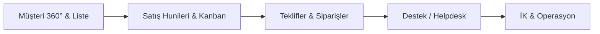

# CRM UI/UX & Bileşen Mimarisi Standartları

> **Durum:** ✅ Aktif / **TEK KANONİK STANDART**  
> **Kapsam:** CRM Platformu (`crm-monorepo/apps/web`, `crm-monorepo/packages/ui`) — `apps/web` içindeki **52 sayfanın tamamı**  
> **Temel Felsefe:** Linear & Stripe ilhamlı temiz kurumsal zanaat (craft), yüksek veri yoğunluğu, sıfır AI-slop dekorasyon.  
> **Karar kaydı:** [`adr/0004-crm-design-system-enforcement.md`](adr/0004-crm-design-system-enforcement.md) · **Yol haritası:** [`crm-ui-roadmap.md`](crm-ui-roadmap.md)

> ⚠️ **Bu dosya tek doğruluk kaynağıdır.** `docs/design-system.md` ve kökteki `design.md` artık buraya yönlendiren stub'lardır (ADR-0004 §1). Yeni kural, token, renk, tipografi veya bileşen kararı **yalnızca buraya** yazılır.

---

## 1. Tasarım Dili ve İlkeler (Design Principles)

### 1.1 Tactile Feel & Kenar Yuvarlaklığı (Border Radius)
- **Kural:** Tüm CRM genelinde `--radius: 0.5rem` (8px) taban alınır.
- **Kartlar & Konteynerler:** `rounded-lg` (8px) veya `rounded-xl` (12px). Bubbly, oyuncak görünümlü `rounded-4xl` hap formları kesinlikle yasaktır.
- **Butonlar & Girdiler:** `rounded-lg` (8px) / `rounded-md` (6px).
- **Rozetler (Badges):** `rounded-md` (6px).
- **Ayrım Çizgileri:** Saydam 1px ince kenarlıklar (`border-border/80` veya `border-border/60`).

### 1.2 Anti-AI-Slop & Renk Disiplini
- **Dekoratif AI Degrade Küreleri Yasak:** Arka planlarda amaçsızca gezinen bulanık renk topları (`blur-3xl bg-blue-500/20 rounded-full`), parıltı efektleri ve rastgele neon parlamalar kullanılmaz.
- **Semantik Renk Token'ları:**
  - `bg-background`, `bg-card`, `bg-muted`
  - `text-foreground`, `text-muted-foreground`, `text-primary`
  - `border-border`, `border-input`, `ring-ring`
- **Durum Renkleri (Status Semantics):**
  - **Başarılı / Aktif:** `emerald` / `success` token'ları (örn. `Active`, `Paid`)
  - **Uyarı / Beklemede:** `amber` / `warning` token'ları (örn. `Pending`, `VIP`)
  - **Bilgi / Potansiyel:** `blue` / `accent` token'ları (örn. `Lead`, `In Progress`)
  - **Hata / Kaybedildi:** `rose` / `destructive` token'ları (örn. `Churned`, `Urgent`)
  - **Nötr / Pasif:** `zinc` / `neutral` token'ları (örn. `Draft`, `Closed`)

### 1.3 Veri Yoğunluğu & Tipografi
- İş yazılımlarında (B2B CRM) ekran alanı değerlidir. Aşırı devasa dolgular (`p-8`, `p-12`) yerine kompakt ve okunabilir hiyerarşi (`p-3.5`, `p-4`) kullanılır.
- **Sayfa başlığı:** `text-2xl font-bold tracking-tight` (`sm:text-3xl`) — bunu `PageHeader` primitifi taşır, sayfalar elle yazmaz.
- **Bölüm / kart başlığı:** `text-sm font-semibold` veya `text-base font-bold` (Tracking: `tracking-tight`).
- Gövde metinleri: `text-xs font-normal`.

**Kanonik tipografi ölçeği:** Keyfi piksel değerleri (`text-[13px]`, `text-[9px]`…) yasaktır. Mikro boyutlar yalnızca iki token'dır:

| Token | Değer | Kullanım |
| --- | --- | --- |
| `text-2xs` | 11px | İkincil detay, meta bilgi (`text-muted-foreground` ile) |
| `text-3xs` | 10px | Mikro etiket (yoğun tablo başlığı, rozet üstü) |

> **9px kaldırıldı** (ADR-0004 §5): veri yoğun bir CRM'de okunmaz ve üçüncü mikro boyutun işlevi yok. Mevcut `text-[9px]` kullanımları `text-3xs`'e (10px) katlanır.

### 1.4 Bağlayıcı Kısıtlar (kaynak değil, sonuç)

> **Temel kural (ADR-0004 §3):** Bir bileşenin **kaynağı** değil, **görsel sonucu** bu standarda tabidir. `shadcn` CLI ile eklenen bir primitif de, elle yazılan da aynı yuvarlaklık, token ve dekorasyonsuzluk kurallarına uymak zorundadır. Uymuyorsa house stiline çekilir.

`crm-ui-guard` tarafından kilitlenen yasaklar:

| Yasak | Yerine |
| --- | --- |
| Keyfi tipografi (`text-[9px]`, `text-[13px]`, `text-[1rem]`…) | `text-2xs` / `text-3xs` veya Tailwind ölçeği (`text-xs`, `text-sm`…) |
| Native `<table>` | `@workspace/ui` `Table` primitifleri (`TableHeader`, `TableRow`, `TableCell`…) |
| Inline `style={{ … }}` (statik değerler) | Tailwind sınıfları + semantic token (`style` yalnızca ölçülemez dinamik değerler için) |
| Native `<select>`, `<input type="date">`, `<input type="number">` | ADR-0002 tablosu: `SelectField`, `Combobox`, `DatePicker`, `DateRangePicker`, `NumberInput` |
| `slate-*`, `violet-*`, `fuchsia-*` | `zinc-*` + `blue-500` skalası |
| Keyfi hex (`bg-[#…]`, `fill="#…"`, `color: "#…"`) | Semantic token + `dark:` varyantları |

**Muafiyetler yalnızca** `crm-monorepo/scripts/crm-ui-guard.allowlist.json` içinde, gerekçesiyle kayıtlıdır. Sessiz istisna yoktur. Bilinen ve belgeli istisna: e-posta / print HTML şablonlarındaki hex paleti (e-posta istemcileri `oklch`/CSS değişkeni desteklemez — teknik zorunluluk).

### 1.5 Motion

Dekoratif animasyon **yoktur**. Motion, işlevi açıklamak için vardır (bir şeyin nereden geldiğini/durumun değiştiğini göstermek), süslemek için değil.

| Token / Değer | Değer | Kullanım |
| --- | --- | --- |
| `ease-crm` | `cubic-bezier(0.32, 0.72, 0, 1)` | Overlay, sheet, drawer giriş/çıkışı (swift-out) |
| `ease-crm-in-out` | `cubic-bezier(0.4, 0, 0.2, 1)` | Boyut/konum geçişleri (simetrik) |
| `duration-150` | 150ms | Hover, press, renk geçişi (`transition-colors`) |
| `duration-200` | 200ms | Overlay giriş/çıkışı — **varsayılan** |
| `duration-250` | 250ms | Sheet / drawer gibi geniş yüzeyler |

> **Neden duration token değil?** Tailwind **4.3.3**'te `--duration-*` diye bir theme namespace'i **yoktur** (yalnızca `--ease-*` ve `--default-transition-duration` vardır). `@theme`'e eklenen bir `--duration-*` hiçbir utility üretmez — okunmayan ölü bir değişken olurdu. Bu yüzden duration **değer** olarak standartlaştırılır, token olarak değil. (Bu tespit Faz 0'da doğrulanmıştır; ADR-0004 §5 bu gerçeğe göre yazılmıştır.)

**Zorunlu:** `prefers-reduced-motion` desteği. Motion ekleyen her bileşen bu tercihi onurlandırmalıdır (`motion-reduce:transition-none` veya eşdeğeri).

---

## 2. Kanonik Primitif Bileşenler (`@workspace/ui/components/*`)

Tüm CRM arayüzlerinde native HTML etiketleri (`<table/>`, `<div>` kart taklitleri) yerine `@workspace/ui` altındaki paylaşılan primitifler kullanılır:

> **Radix tek foundation'dır**; Base UI tabanlı bileşen alınmaz. Bu tabloda **olmayan** bir şeyi dışarıdan getirmeyin: bir bileşen `packages/ui`'de zaten varsa (ör. `Badge`, `PhoneInput`, `NumberInput`) ikinci bir kopya oluşturulmaz. `packages/ui` her zaman kazanır.

| Primitif | Dosya | Kullanım Amacı |
|---|---|---|
| `Card` | `card.tsx` | Veri blokları, özet panelleri (`CardHeader`, `CardTitle`, `CardContent`, `CardFooter`) |
| `Badge` | `badge.tsx` | Durum, segment ve tip etiketleri (8 varyant: `default`, `secondary`, `outline`, `destructive`, `success`, `warning`, `accent`, `neutral`) |
| `Button` | `button.tsx` | Aksiyonlar (`variant`: `default`, `outline`, `secondary`, `ghost`, `destructive`, `link`; `size`: `xs`, `sm`, `default`, `lg`, `icon`, `icon-xs`, `icon-sm`, `icon-lg`) |
| `Table` | `table.tsx` | Yüksek veri yoğunluklu listeler (`TableHeader`, `TableBody`, `TableRow`, `TableHead`, `TableCell`) |
| `Tabs` | `tabs.tsx` | Sekmeli görünümler (`TabsList`, `TabsTrigger`, `TabsContent`) |
| `Avatar` | `avatar.tsx` | Kullanıcı/müşteri görselleri ve harf fallback'leri (`AvatarImage`, `AvatarFallback`) |
| `Skeleton` | `skeleton.tsx` | Sayfa ve widget veri yüklenme durumları |
| `EmptyState` | `empty-state.tsx` | Veri bulunamadı veya ilk kayıt ekleme durumu (`icon`, `title`, `description`, `action`) |
| `Input` & `Label` | `input.tsx`, `label.tsx` | Form giriş alanları ve etiketleri |
| `Checkbox` | `checkbox.tsx` | Çoklu seçim ve onay kutuları |
| `SelectField` / `Select` | `select.tsx` | ≤7 sabit seçenek (`SelectField`) veya düşük seviye `Select` |
| `Combobox` | `combobox.tsx` | >7 seçenek / arama gerektiren seçim |
| `NumberInput` | `number-input.tsx` | Para (`precision=2`, `suffix=" ₺"`) ve adet (`precision=0`, stepper) |
| `PhoneInput` | `phone-input.tsx` | Telefon (+ `formatPhoneNumber`, `validatePhoneNumber`) |
| `DatePicker` / `DateRangePicker` | `date-picker.tsx` | Tarih ve aralık (`YYYY-MM-DD`, TR locale) |
| `TimePicker` | `time-picker.tsx` | Saat seçimi (`HH:mm`) |
| `ConfirmDialog` | `confirm-dialog.tsx` | Silme/onay akışları (`variant: destructive \| warning \| default`) |
| `Tooltip` | `tooltip.tsx` | Kısa açıklamalar (`TooltipProvider` gerekir) |
| `Toaster` / `toast` | `sonner.tsx` | Bildirimler |
| `Textarea` | `textarea.tsx` | Çok satırlı metin |
| **`Dialog`** | `dialog.tsx` | **Faz 1** — modal pencereler (`DialogContent`, `DialogHeader`, `DialogTitle`, `DialogFooter`, `DialogClose`) |
| **`AlertDialog`** | `alert-dialog.tsx` | **Faz 1** — yıkıcı/önemli onaylar (`AlertDialogContent`, `AlertDialogAction`, `AlertDialogCancel`, `AlertDialogMedia`) |
| **`Sheet`** | `sheet.tsx` | **Faz 1** — yan panel / drawer (`SheetContent`, `SheetHeader`, `SheetFooter`, `SheetSide`) |
| **`DropdownMenu`** | `dropdown-menu.tsx` | **Faz 1** — açılır menüler (`DropdownMenuItem`, `DropdownMenuLabel`, `DropdownMenuSeparator`, `DropdownMenuSub`) |
| **`Popover`** | `popover.tsx` | **Faz 1** — bağlamsal katmanlar (`PopoverContent`, `PopoverTrigger`, `PopoverAnchor`) |
| **`Switch`** | `switch.tsx` | **Faz 1** — boolean ayarlar |
| **`RadioGroup`** | `radio-group.tsx` | **Faz 1** — seçenek grupları (`RadioGroupItem`) |
| **`Progress`** | `progress.tsx` | **Faz 1** — ilerleme/yükleme göstergeleri |
| **`Separator`** | `separator.tsx` | **Faz 1** — ayraçlar (`orientation`, `decorative`) |
| **`ScrollArea`** | `scroll-area.tsx` | **Faz 1** — özel kaydırma alanı (`ScrollBar`) |
| **`Alert`** | `alert.tsx` | **Faz 1** — satır içi uyarı/bilgi kutuları (`AlertTitle`, `AlertDescription`, `AlertAction`) |

**Hedef (Faz 3):** Elle yazılmış ~60 modal ve 156 `fixed inset-0` overlay'inin bu primitiflerle tasfiyesi.

### 2.1 Primitif Ekleme Prosedürü (`shadcn` CLI)

Yeni primitif **yalnızca** `shadcn` CLI ile eklenir (stil `radix-luma`), ardından house stiline uyarlanır. CLI iki tuzağı vardır — Faz 1'de birebir karşılaşılmıştır:

```sh
# DOĞRU kullanım (repo kökü: crm-monorepo/)
npx shadcn add <bilesen> --cwd packages\ui --dry-run      # 1) önce önizle
npx shadcn add <bilesen> --cwd packages\ui -y             # 2) sonra yaz
```

> **⚠️ Tuzak 1 — CLI mevcut dosyaları ezmek ister.** `dialog`, `alert-dialog` ve `sheet` bağımlılık olarak `button` çeker ve CLI `button.tsx`'i registry sürümüyle **ezmeyi teklif eder**. Registry sürümü `rounded-lg` yerine **`rounded-4xl`** kullanır — yani §1.1'in açıkça yasakladığı hap form. Onaylanırsa 52 ekrandaki tüm butonlar bozulur. **Kabul etmeyin.** Gerekirse dosyayı geçici olarak kenara alıp CLI'ı çalıştırın, sonra `git checkout -- packages/ui/src/components/button.tsx` ile geri alın ve `git diff` ile içeriğin değişmediğini kanıtlayın.
>
> **⚠️ Tuzak 2 — CLI yanlış npm bağımlılığı kurar.** Üretilen dosyalarda `import { cn } from "cn"` yazar ve `packages/ui/package.json`'a **`cn` npm paketini ekler**. Bu projede `cn` `@workspace/ui/lib/utils`'ten gelir; ikinci bir sınıf-birleştirme kütüphanesi kabul edilmez. Her yeni dosyada import `@workspace/ui/lib/utils` olarak düzeltilmeli ve `cn` bağımlılığı `package.json`'dan kaldırılmalıdır (`npm install` ile lock senkronlanır).

**Uyarlama kontrol listesi (her yeni primitif):** import yolu · `rounded-4xl` yok (→ `rounded-xl`/`rounded-lg`) · `ring-2` (`ring-3` değil) · semantic token (hex/slate/violet yok) · dekoratif gradient/blur yok · `prefers-reduced-motion` desteği · **`npx prettier --check` temiz** (`.prettierrc`: `semi: false` — noktalı virgül **yok**).

> **⚠️ Uyarı:** `packages/ui/src/components/` altındaki eski 21 primitif `.prettierrc`'ye **uymuyor** (noktalı virgüllü; config `semi: false` diyor). Yeni dosyalar uyumlu. `npm run format` bir gün çalıştırılırsa 21 dosya toplu değişir — bu bilinçli bir temizlik geçişi olarak yol haritasında kayıtlıdır.

### 2.2 Kanonik Sayfa Kabuğu

Tüm sayfalar (**52 ekran** — dashboard + admin + auth + portal) aynı kabuğu kullanır. **Navigasyon yüzeye özeldir**; kabuk, boşluk, tipografi ve renk dili ortaktır. Login ekranı ile müşteri listesi aynı navigasyona sahip olmak zorunda değil, ama aynı dilde konuşmak zorundadır.

| Primitif | Görev |
| --- | --- |
| `PageContainer` | Sayfa gövdesi: `px-4 py-5` / `md:px-6 md:py-6`. **Tam genişlik** — `max-width` sınırı yok (veri yoğun CRM'de geniş ekran harcanmaz, 4K'da beyaz kenar üretilmez) |
| `PageHeader` | Başlık / açıklama / aksiyonlar |

**Terk edilen boşluk varyantları:** `p-4 md:p-6`, `p-4 pt-6 md:p-8`, `p-5`, `p-8`, `p-10`, `p-12` — hepsi tek değere iner.

**Padding'in tek sahibi `PageContainer`'dır.** Layout'lar yalnızca kaydırma alanı ve mobil bottom-nav payını (`pb-24`) sağlar; **sayfalar kendi `p-*`/`px-*` sınıflarını yazmaz.** Sayfa kendi padding'ini eklerse layout'un padding'iyle üst üste biner — drift'in en yaygın biçimi buydu.

**İstisna — form ekranları `max-width` kullanabilir.** "Tam genişlik, max-width yok" kuralı veri yoğun liste/tablo ekranları içindir. Tek sütunlu form sayfaları okunabilirlik için `max-w-3xl`/`max-w-4xl` gibi bir üst sınır taşıyabilir; bu, `PageContainer`'ın `className`'i olarak verilir. `max-width` **liste/tablo** ekranlarında yasaktır (ör. `max-w-[1600px]` kaldırıldı).

**Muafiyetler — kabuk kullanmayan yüzeyler (8 dosya):**

| Yüzey | Neden muaf |
| --- | --- |
| `orders/[orderId]/print` | `@media print` padding'i sıfırlıyor; içerik kendi boşluğunun sahibi |
| `(auth)/login`, `(auth)/register` | Layout'u yok; `min-h-screen` ile tam ekran merkezleme kuruyor |
| `portal/[token]`, `quotes/view/[token]` | Bağımsız genel yüzeyler — dashboard layout'u kullanmıyorlar |
| `/pipelines`, `/quotes`, `/` (kök) | Layout'suz genel / loading sayfaları |

Muaf yüzeylerde ortaklık **token, primitif ve tipografi** düzeyinde sağlanır. Zorla kabuk giydirmek tam ekran merkezlemeyi bozar — login ekranı login gibi görünmez.

**Kural:** yeni bir ekran açarken ya `PageContainer` kullanın ya da muafiyet gerekçesini bu tabloya yazın. **Sessiz muafiyet yoktur.**

> **Durum:** ✅ `PageContainer` + `PageHeader` **Faz 2'de eklendi ve 44 sayfaya uygulandı** (8 belgelenmiş muafiyet). Yeni sayfa açarken bu kabuğu kullanın; **kendi boşluk varyantınızı icat etmeyin**.

### 2.3 Overlay Göçü Tarifi (Faz 3)

Elle yazılmış bir modal/overlay'i primitife çevirme adımları — Faz 3.0 pilotunda doğrulandı:

1. **Kapsayıcıyı kaldır:** `fixed inset-0 z-50 flex animate-in items-center justify-center p-4` gibi el yapımı sarmalayıcı silinir.
2. **Backdrop'u sil:** iki biçimde karşına çıkar — (i) `fixed inset-0 bg-black/60 backdrop-blur-*` + `onClick` div'i, (ii) tam boy `<button aria-label="Kapat" className="fixed inset-0 …">`. İkisi de gider: `DialogOverlay`/`SheetOverlay` backdrop'u sağlar, Radix dışına tıklamayı zaten yönetir. Buton biçimini silmek hiçbir şey kaybettirmez — yaptığı işi primitif doğru yapıyor.
3. **Paneli primitife ver:** panelin kendi `rounded-* border bg-* shadow-*` sınıfları gider; yüzeyi primitif sahiplenir. Yalnızca **boyut/yerleşim** sınıfları `DialogContent`'e geçer (`max-w-2xl`, `max-h-[90vh]`, `flex flex-col`, `p-0 gap-0` gibi).
4. **Görünen başlığı `DialogTitle` yap:** Radix erişilebilir isim arar; eksikse konsol uyarır ve ekran okuyucu başlığı okuyamaz.
5. **Mevcut kapatma butonunu `DialogClose asChild` ile sar:** böylece yardımcı teknoloji onu kapatma kontrolü olarak bulur. `DialogContent`'in kendi X'i istenmiyorsa `showCloseButton={false}`.
6. **Açık/kapalıyı primitife bırak:** `open` + `onOpenChange={(o) => { if (!o) onClose(); }}`. Özel `onClick` backdrop mantığı yazılmaz.
7. **Açıklama yoksa** `DialogContent`'e `aria-describedby={undefined}` ver (Radix uyarısını susturur).

**Kazanç:** backdrop, z-index katmanı, giriş/çıkış animasyonu, focus tuzağı, `Esc`, `aria-modal` ve dışına tıklayınca kapanma **tek yerden** gelir.

**Boyut aktarımı — taban `max-width` primitife aittir.** Panelin kendi genişliği `className`'e geçer, ama **taban (base) `max-width` yazılmaz.** `DialogContent` varsayılanı `w-full max-w-[calc(100%-2rem)]`'dir ve silinen `p-4` sarmalayıcısının **mobil kenar payını** üreten tam da budur. Koşulsuz `max-w-2xl` bu payı siler:

| | 375px | 500px | 900px |
| --- | --- | --- | --- |
| El yapımı (`p-4` sarmalayıcı + `max-w-2xl`) | 343 | 468 | 672 |
| `w-full max-w-2xl` ❌ | **375** | **500** | 672 |
| `w-full sm:max-w-2xl` ✅ | 343 | 468 | 672 |

**Kural:** genişlik `sm:` ve üstü için yazılır (`sm:max-w-2xl`), taban için yazılmaz. `w-full` zaten varsayılandır; yazmak zararsız ama gereksiz.

**Dışına tıklama politikası — varsayılan açık, ama çıktı kaybı varsa kapat.** `Dialog`/`Sheet`/`Popover` dışına tıklayınca kapanmayı **varsayılan olarak** getirir ve bu istenen kazançtır. Tek istisna: kapanmak, kullanıcının **yeniden üretemeyeceği bir çıktıyı** yok ediyorsa dış-tıklama etkisizleştirilir.

| Durum | Karar | Örnek |
| --- | --- | --- |
| Yazılmış form taslağı | **Varsayılan uygulanır** — yeniden yazılabilir | `campaign-modal` (5 adımlı sihirbaz) |
| Yerel/`localStorage` durumu | **Varsayılan uygulanır** — kayıp yok | `quick-actions-widget` |
| Başka yerde görünmeyen üretilmiş çıktı | **Engellenir** | `bulk-coupon-modal` (üretilen kupon kodları) |

```tsx
// Sadece geri alınamaz çıktı varsa; Esc çalışmaya devam eder.
onInteractOutside={(event) => {
  if (generatedResult) {
    event.preventDefault();
  }
}}
```

**Neden koşullu:** `bulk-coupon-modal`'da üretimden **önce** dış-tıklama normal çalışsın (formdan çıkmanın yolu), üretimden **sonra** etkisiz olsun diye. Esc her durumda açık kalır — bu bilinçli bir tuş, kazara bir tıklama değil.

**Kontrol listesi eklemesi — açılış ve kapanışı SAY.** Faz 2'de olduğu gibi Faz 3'te de bu tuzağa düşüldü (`TS17002`, iki kez): açılış tarafında iki `div`'i tek bir primitifle değiştirip kapanışta bir `</div>` bırakmak, JSX'i bozar. Kapanışı **desen eşleştirerek değil**, açılış/kapanış sayısını eşleştirerek kur:

```
<Dialog          n   </Dialog>          n
<DialogContent  n'   </DialogContent>  n'
```

`tsc` bunu her zaman yakalar — ama yalnızca **her dosyadan sonra** çalıştırılırsa.

**Overlay OLMAYAN yüzen yüzeyler (kapsam dışı).** Aşağıdakiler §2.3/§2.4'e **girmez**; backdrop'ları, kapatmaları ve focus yönetimleri yoktur, arkadaki sayfayı engellemezler:

| Dosya | Neden overlay değil |
| --- | --- |
| `bulk-action-bar` | Seçim bitene kadar duran alt araç çubuğu; `shadow-2xl` bir yükselti, modal paneli değil |
| `widgets/draggable-widget-wrapper` | Widget üzerinde hover'da çıkan **sürükleme tutamacı** (`opacity-0 group-hover:opacity-100`) |
| `layout/dashboard-header` | `sticky` başlığın **fonksiyonel** `backdrop-blur-md`'si (dekoratif değil) |
| `settings/page` içindeki kart | Kart yüzeyinde dekoratif `backdrop-blur-sm` → §1.2/cilâ işi, overlay işi değil |

**Print — overlay'ler ekran kromu, asla basılmaz.** `globals.css`'in `@media print` bloğu backdrop'ları gizler:

```css
[data-slot="dialog-overlay"],
[data-slot="sheet-overlay"],
[data-slot="alert-dialog-overlay"],
[data-slot$="-backdrop"] { display: none !important; }
```

**Neden global:** primitifler overlay'i portal içinde **içeriğin kardeşi** olarak render ediyor; `SheetContent` yalnızca panel için `className` alır → çağrı yerinden backdrop'a print sınıfı verilemez. Tek yerde yapmak hem tüm overlay'leri kapsar hem de elle yazılmış backdrop'ları (`fixed inset-0 bg-black/40`) temizler — bu dosya `print-color-adjust: exact` zorladığı için onlar **şu an basılıyordu**.

**Yalnız backdrop gizlenir, içerik gizlenmez.** Çünkü bazı yüzeyler *print hedefi*: `invoices` detay drawer'ı `print:max-w-none print:shadow-none` taşır, başlığı `print:hidden`'dır ve `handlePrint` drawer açıkken `window.print()` çağırır. Backdrop'u gizlemek tam olarak o akışın istediği şeydir.

**⚠️ Print'te sınıf ezmesi ayrı bir özgüllük problemidir.** `print:max-w-none` **temel varyantta** derlenir; `data-[side=right]:sm:max-w-2xl` ise data-attribute + breakpoint taşır ve **özgüllükte kazanır**. Yani print'te genişliği gerçekten değiştirmek istiyorsanız önekli biçim gerekir. Bugün A4 + 12mm marj ≈ 703px, `2xl` = 672px → pratikte neredeyse tam genişlik, ama bu **tesadüf**, garanti değil.

**Portallanmış `fixed` konumlandırma print'te kırılgandır** ve bu commit'ler onu çözmez — drawer'ı print yüzeyi olarak yeniden düşünmek gerekir (Gelecek Adımlar).

**`Sheet` (drawer) için ek notlar** — adımlar aynı, üç fark var:

1. **Yön:** `side="right"` (varsayılan) · `"left"` · `"top"` · `"bottom"`. Mobil navigasyon drawer'ı `side="left"`.
2. **Genişlik varsayılanı dar:** `SheetContent` sağ/sol için `w-3/4 sm:max-w-sm` gelir — ama bunlar **varyant önekli** (`data-[side=right]:`). Geniş panel gerekiyorsa ezme de **aynı öneki taşımalıdır** (bkz. aşağıdaki kural): `data-[side=right]:w-full data-[side=right]:sm:max-w-4xl`.
3. **`SheetContent` varsayılan olarak `flex flex-col`:** yan yana iki sütunlu bir drawer (ör. liste + sohbet) `flex-row` ister.

> **`className` ezmesi nerede güvenli, nerede sessizce başarısız:** `cn()` **tailwind-merge** kullanır, ama yalnızca **aynı modifier listesine** sahip utility'lerde sonuncuyu tutar.
>
> | Ezme | Sonuç |
> | --- | --- |
> | `flex-col` + `flex-row` | ✅ `flex-row` (ikisi de modifiersız) |
> | `w-3/4` + `w-full` | ✅ `w-full` (ikisi de modifiersız) |
> | `data-[side=right]:w-3/4` + `w-full` | ❌ **ikisi de kalır** — modifier listeleri (`[data-[side=right]]` ≠ `[]`) eşleşmez |
>
> Üçüncü durumda `cn()` çıktısında iki utility birlikte bulunur ve kararı **CSS özgüllüğü** verir: `data-[side=*]` önekli kural `(0,2,0)`, düz olan `(0,1,0)` → **primitif kazanır.** Hata vermez; sadece istediğiniz genişlik uygulanmaz. Kanıt derlenmiş stylesheet'ten:
>
> ```css
> .data-\[side\=right\]\:w-3\/4[data-side=right]{width:75%}              /* (0,2,0) */
> .w-full{width:100%}                                                     /* (0,1,0) */
> .data-\[side\=right\]\:sm\:max-w-sm[data-side=right]{max-width:…sm}     /* (0,2,0) */
> .sm\:max-w-4xl{max-width:…4xl}                                          /* (0,1,0) */
> ```
>
> **Kural:** varyant önekli bir varsayılanı ezmek için **aynı öneki kullanın.**
> ```tsx
> className="data-[side=right]:w-full max-w-4xl data-[side=right]:sm:max-w-4xl flex-row"
> ```
> Bu tuzağı taşıyan varsayılanlar: `sheet.tsx` (`data-[side=*]:w-3/4`, `:sm:max-w-sm`) ve `alert-dialog.tsx` (`data-[size=*]:max-w-xs`, `:sm:max-w-md`). Yeni bir primitif eklerken genişlik varsayılanını **öneksiz** yazmayı tercih edin.

**Kazanç (Sheet):** kenardan kayma animasyonu, `Esc`, dışına tıklama, focus tuzağı ve katman yönetimi primitiften gelir.

**Kapsam disiplini:** bu geçişte dosyadaki ADR-0002 ihlalleri (native `<select>`, `type="number|date"`) **düzeltilmez** — onlar Faz 5'in işi. Bir geçişte tek değişken değiştirilir; aksi halde bir hata çıktığında hangi değişikliğin yol açtığı ayırt edilemez.

### 2.4 Popover & DropdownMenu Göçü (Faz 3 alt-deseni)

Elle konumlanan **tetikleyici + panel** çiftleri (bildirim merkezi, paylaş menüsü, çalışma alanı seçici) için adımlar §2.3 ile aynıdır; fark, **konumlandırmanın sahibinin** değişmesidir.

1. **Kök sarmalayıcının `relative`'ini ve `useRef`'ini kaldır:** ikisi de yalnızca "tıklama içeride mi" testi ve `absolute` konumlama içindi. İkisi de primitifin işi.
   > `className` prop'u alan bir bileşense tek bir `<div className="inline-block …">` kalabilir — ama `relative` **kalmaz**, içerik portal üzerinden gider.
2. **Elle yazılmış dinleyicileri sil:** `mousedown` click-outside + `keydown` Escape `useEffect`'leri gider. `Popover` dışına tıklamayı, `Esc`'i ve odağın tetikleyiciye dönmesini kendisi yönetir.
3. **`useId()` ile kurulan `aria-controls` bağlantısını sil:** `PopoverTrigger` kendi id'sini üretip bağlar; `aria-expanded` ve `aria-haspopup="dialog"` da ondan gelir. **Elle yazılmış `role="dialog"` da gider** (`PopoverContent` zaten taşır). Tetikleyicinin kendi `aria-label`'ı **kalır** — primitifin bilemeyeceği bilgi (ör. okunmamış sayısı).
4. **Tetikleyiciyi `PopoverTrigger asChild` yap, elle `onClick` toggle'ını sil:** kontrollü `open` + `onOpenChange` ile toggle primitiften gelir. İkisi birlikte kalsa aynı değeri hesapladıkları için çalışır, ama toggle mantığı ikiye bölünür.
5. **Kapanışta sıfırlanan yerel state'i `onOpenChange`'e taşı:** eski click-outside dinleyicisi `setX(false)` de yapıyordu. Artık:
   `onOpenChange={(o) => { setOpen(o); if (!o) setX(false); }}` — üstelik `Esc` ve dışa tıklama dâhil **her** kapanışta çalışır.
6. **Konumlandırma prop'lara çevrilir:**

| Elle yazılmış | Primitif |
| --- | --- |
| `absolute top-full left-0 mt-1.5` | `side="bottom" align="start" sideOffset={6}` |
| `absolute top-0 left-full ml-3.5` | `side="right" align="start" sideOffset={14}` |
| `sm:right-0` | `align="end"` |
| `w-full` (tetikleyici genişliği kadar) | `w-(--radix-popover-trigger-width)` |

7. **Yüzey `PopoverContent`'e geçer:** varsayılanları ez (`gap-0 p-0`, `w-72`), `rounded-*`/`border`/`bg-*`/`shadow-lg`/`animate-*`/`z-50` yazma.

**Mobil "başlık altı tam genişlik" deseni.** Bazı paneller mobilde `fixed inset-x-3 top-14` ile başlığın altına yapışıyordu. `Popover` yalnızca **çapaya** göre konumlandığı için bu birebir üretilemez. Tetikleyici başlığın içindeyse sonuç aynı yere düşer:

```tsx
<PopoverContent
  align="end"
  className="w-[calc(100vw-1.5rem)] gap-0 overflow-hidden p-0 sm:w-96"
  collisionPadding={12}   /* inset-x-3'ün 12px payını korur */
  side="bottom"
  sideOffset={10}
/>
```

Bu **yaklaşımdır, kanıt değil**: tetikleyici başlıktan uzaklaşırsa panel de onunla gider. Takas bilinçlidir — sabit `top-14` yerine konumlandırma ve çarpışma yönetimi primitife geçer.

**`DropdownMenu` ne zaman?** İçerik **menü öğelerinden** oluşuyorsa (`DropdownMenuItem`, roving focus, `CheckboxItem`/`RadioItem` semantiği). Panelin içinde arama alanı, serbest form ya da özel içerik varsa **`Popover`** doğru seçimdir — menü semantiği bunlara uymaz.

**Kapsam dışı — overlay olmayan yüzen yüzeyler:** listesi §2.3'te (`bulk-action-bar`, sürükleme tutamacı, sticky başlık, dekoratif kart blur'u). §2.4 de yalnızca **tetikleyici + panel** çiftlerine uygulanır.

> **Üç overlay primitifi tek standartta:** `DialogContent`, `SheetContent`, `PopoverContent`, `AlertDialogContent` → hepsi `rounded-xl`. Bir primitif `rounded-3xl` ile yazılırsa (§1.1 dışı) **önce primitif düzeltilir, sonra tüketiciler ona taşınır** — aksi halde ihlal çağrı yerlerine yayılır (bkz. §2.3 bulgu 1 ve `db8cf6e`).

---

## 3. Sayfa ve Bileşen Ayrıştırma Mimarisi (Architecture & Decomposition)

### 3.1 300 Satır Kuralı (Single Responsibility)
- Tek bir `page.tsx` dosyası **asla 300-400 satırı aşmamalıdır.**
- `page.tsx` yalnızca bir **orkestratör (coordinator)** olmalıdır:
  - Route parametrelerini (`useParams`) okur.
  - İstemci durumunu (`useState`, `useCallback`) ve veri çekme döngüsünü (`ApiClient`) yönetir.
  - Yetki kontrolünü (`usePermissions`) bağlar.
  - Görünüm ve modalları alt bileşenlere delege eder.

### 3.2 Dizin Standardı: `_components/`
Her ana rota için alt bileşenler o rotanın dizinindeki `_components/` klasöründe toplanır:
```text
app/(dashboard)/[tenantSlug]/customers/
├── page.tsx                             # ~260 satır ana koordinatör
└── _components/
    ├── customer-stats-banner.tsx        # 4 KPI metrik kartı
    ├── customer-filters-bar.tsx         # Arama, filtreler, dışa aktarım, görünüm toggle
    ├── customer-table-view.tsx          # Tablo görünümü + Checkbox + Badge + Aksiyonlar
    ├── customer-grid-view.tsx           # Kart grid görünümü
    ├── create-customer-modal.tsx        # Yeni müşteri ekleme penceresi
    └── delete-customer-dialog.tsx       # Silme onay modalı

app/(dashboard)/[tenantSlug]/customers/[customerId]/
├── page.tsx                             # ~260 satır ana koordinatör
└── _components/
    ├── customer-detail-header.tsx       # Geri butonu, unvan, aksiyon butonları
    ├── customer-sidebar-summary.tsx     # İletişim, temsilci, VKN bilgileri
    ├── customer-tabs-content.tsx        # 8 sekmeli tuval ve alt görünümler
    ├── add-contact-modal.tsx            # Şirket yetkilisi ekleme modalı
    ├── add-activity-modal.tsx           # Etkileşim/aktivite ekleme modalı
    └── edit-customer-modal.tsx          # Müşteri düzenleme modalı
```

---

## 4. Gerçekleştirilen Başlıca Revizyonlar (Changelog)

### 4.1 Global Dashboard Kabuğu (`apps/web/app/(dashboard)/layout.tsx`)
- **Önceki Durum:** 1.350 satırlık devasa monolit, karmaşık switch-case'ler, iç içe menü render fonksiyonları.
- **Yapılan İyileştirme:** 215 satıra indirildi. `apps/web/components/layout/` altında 6 modüler bileşene bölündü:
  - `nav-config.ts`: Hub tanımları (CRM, OPS, HRM, CMS, SYS), rota eşlemeleri ve yetki filtreleri.
  - `hub-rail.tsx`: Sol 64px ray, anlık tooltip'ler, tenant ve kullanıcı profil tetikleyicileri.
  - `sub-nav-rail.tsx`: Katlanabilir alt navigasyon rayı, ⌘K arama tetikleyicisi.
  - `dashboard-header.tsx`: Mobil ve duyarlı üst bar.
  - `mobile-nav.tsx`: Mobil drawer ve alt bar.
  - `keyboard-shortcuts-listener.tsx`: `gd`, `gp`, `nc`, `?` kısayol dinleyicisi.

### 4.2 Ana Dashboard Genel Bakış (`[tenantSlug]/page.tsx`)
- Üst filtre barı `@workspace/ui` `Button` ve `Badge` primitiflerine geçirildi.
- `kpi-metrics-widget.tsx`: Yapay AI gradyan parlamaları kaldırıldı; `Card`, `Badge`, `Skeleton` entegre edildi.
- `deals-table-widget.tsx`: `Table`, `Badge`, `EmptyState` ve `Button` ile yeniden yazıldı.

### 4.3 Müşteri Listesi (`/customers`)
- 1.364 satırlık monolit sayfa 260 satıra indirildi.
- 4'lü KPI istatistik banner'ı, gelişmiş filtreleme barı, yüksek veri yoğunluklu tablo görünümü, kart ızgara görünümü ve modallar ayrıştırıldı.

### 4.4 Müşteri 360° Detay Sayfası (`/customers/[customerId]`)
- 2.105 satırlık monolit sayfa 260 satıra indirildi.
- Temel iletişim & temsilci özeti sol sütuna, 8 sekmeli ana etkileşim tuvali sağ sütuna yerleştirildi.
- Timeline (Aktivite Geçmişi), Dahili Notlar (Yerinde düzenleme & iğneleme), Satış Fırsatları, Teklifler, Siparişler, Destek Biletleri ve Finansal Bakiye sekmeleri modern primitiflerle donatıldı.

### 4.5 Kod Temizliği ve Derleme Başarısı
- **Temizlenen Monolitik Kod:** Toplam **~4.500 satır** spagetti kod elendi.
- **TypeScript Doğrulaması:** `packages/ui` ve `apps/web` içinde `0` hata (`tsc --noEmit` exit code 0).
- **Production Build:** Next.js 16 Turbopack derlemesinde tüm 30+ rota başarıyla derlendi.

---

## 5. Yol Haritası ve Önerilen Sıradaki Adımlar (Roadmap)

Aynı mimari ve tasarım standartlarının platformun diğer temel modüllerine yaygınlaştırılması hedeflenmektedir:



### Aşama 1: Satış Hunileri & Kanban Panosu (`/[tenantSlug]/pipelines`)
- Sürükle-bırak aşama sütunlarının (`drag-and-drop`) performans optimizasyonu.
- Aşama bazlı toplam tutar ve adet kartlarının Linear/Stripe kart standartlarına uyarlanması.
- Anlaşma (`Deal`) kartlarındaki etiketlerin `Badge` primitifine dönüştürülmesi.

### Aşama 2: Teklifler & Siparişler (`/[tenantSlug]/quotes` & `/[tenantSlug]/orders`)
- Yüksek yoğunluklu `Table` bileşeni kullanımı.
- Teklif revizyon geçmişi ve onay akışlarının görselleştirilmesi.
- Yazdırma ve PDF önizleme şablonlarının tipografik kalitesinin yükseltilmesi.

### Aşama 3: Destek Talepleri & Helpdesk (`/[tenantSlug]/tickets`)
- SLA ihlal göstergelerinin belirginleştirilmesi.
- Canlı mesajlaşma akışının modern konuşma balonları (`chat bubbles`) ve zaman damgalarıyla zenginleştirilmesi.
- Kategori ve öncelik rozetlerinin standartlaştırılması.

### Aşama 4: Operasyon ve İK Modülleri (`/attendance`, `/payroll`, `/field-service`)
- `DatePicker`, `DateRangePicker` ve `NumberInput` kullanımının ADR-0002 doğrultusunda eksiksiz kilitlenmesi.
- Puantaj ve bordro tablolarının taranabilirliğinin artırılması.
