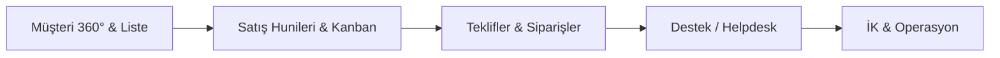

# CRM UI/UX & Bileşen Mimarisi Standartları

> **Durum:** ✅ Aktif / **TEK KANONİK STANDART**  
> **Kapsam:** CRM Platformu (`apps/web`, `packages/ui`) — `apps/web` içindeki **52 sayfanın tamamı**  
> **Temel Felsefe:** Linear & Stripe ilhamlı temiz kurumsal zanaat (craft), yüksek veri yoğunluğu, sıfır AI-slop dekorasyon.  
> **Karar kaydı:** [`adr/0004-crm-design-system-enforcement.md`](adr/0004-crm-design-system-enforcement.md) · **Yol haritası:** [`crm-ui-roadmap.md`](crm-ui-roadmap.md)

> ⚠️ **Bu dosya tek doğruluk kaynağıdır.** `docs/design-system.md` ve kökteki `design.md` artık buraya yönlendiren stub'lardır (ADR-0004 §1). Yeni kural, token, renk, tipografi veya bileşen kararı **yalnızca buraya** yazılır.

---

## 0. v2 kabuğu — yürürlükte (2026-11-14)

> Aşağıdaki maddeler §0.4'te listelenen eski maddelerin **yerine geçer**; çelişkide burası kazanır.
> Uygulama kaydı ve fazlar: `.scratch/ui-refresh-2026-11/spec.md`. Yürürlük kanıtı: kabuk, dashboard, satış, kayıt/para, 18 modül, auth/admin.

### 0.1 Renk ve yüzey

| Token | Açık | Rol |
|---|---|---|
| `--background` | `#EDEFF3` | Uygulama tuvali (gri). **Beyaz yüzey `bg-card`'dır** |
| `--card` | `#FFFFFF` | Kabuk, kart, tablo |
| `--foreground` | `#16181D` | Birincil metin |
| `--muted-foreground` | `#68707D` | İkincil metin — beyazda **4.5:1** (ölçüldü) |
| `--muted` | `#F4F5F8` | Dolgu, hover, segment rayı |
| `--border` / `--input` | `#ECEEF3` / `#E4E7EC` | 1px ayraç / form kenarı |
| `--primary` | periwinkle `#6D5BE8` ailesi | Aksan: aktif durum, odak, seri 1 |
| `--success` · `--warning` · `--danger` · `--info` | `#12B76A` · `#F79009` · `#F04438` · `#2E90FA` | Durum çekirdeği |
| `*-soft` / `*-ink` | örn. `#ECFDF3` / `#067647` | Çip yüzeyi + çip metni **birlikte** yazılır |

`--muted-foreground`, `--primary` ve durum çiftleri WCAG AA (4.5:1) için ölçülerek ayarlandı; **tema başına çalışma-zamanı denetimi** `apps/web/e2e/theme-audit.spec.ts` (açık ve koyu projeler). 2026-11-14: 31 rotada **0 düşük kontrast düğümü**.

### 0.2 Kabuk

- Tek beyaz kabuk: 232px sidebar + 54px üst bar + kaydırma alanı. Çift ray (64px ikon + 225px menü) **kaldırıldı**.
- 5 hub, sidebar'ın üstündeki 24px şeritte (`CRM/OPS/HRM/CMS/SYS`); nav öğeleri 30px satır.
- Üst bar: geri, breadcrumb, komut araması (`⌘K`), bildirim, kısayollar. Sayfa aksiyonları `PageHeader`'da kalır.
- Masaüstünde tuval boşluğu 10px (`md:p-2.5`), kabuk `rounded-2xl` + `shadow-shell`.
- Sidebar daraltıldığında üst bardaki düğmeyle geri açılır; mobil drawer/bottom nav davranışı değişmedi.

### 0.3 Ölçek

| Öğe | Değer |
|---|---|
| Yarıçap | kabuk 14 (`rounded-2xl`) · kart/modal 11 (`rounded-xl`) · buton/girdi 8 (`rounded-lg`) · çip 5 |
| Gölge | `shadow-card` (kart, neredeyse düz) · `shadow-shell` (kabuk) · `shadow-lift` (yüzen/sürüklenen) |
| Tipografi | sayfa başlığı 23–24px/650 · kart başlığı 14px/600 · gövde 12.5px · meta 11px · tablo başlığı 9px uppercase +0.06em |
| Yoğunluk | nav 30px · tablo satırı 44px · içerik dolgusu `px-4 py-4 md:px-6 md:py-5` |
| Motion | hover 150ms `ease-out` · katman 200ms · `prefers-reduced-motion` global |

### 0.4 Yürürlükten kalkan / değişen maddeler

- **§1.1:** 8px taban kalır; **kabuk 14 ve kart 11 artık izinli**. "Bubbly hap form yasak" aynen geçerli.
- **§1.2:** `--primary` periwinkle **token değeridir**; `violet-*`/`fuchsia-*`/`slate-*` **sınıf** yasağı aynen sürer. Faz 4'teki 920 `violet→blue` göçü geri alınmadı.
- **§1.2 / Gelecek #24:** `--success` / `--warning` / `--danger` / `--info` + `-soft`/`-ink` eklendi; yeni çipler skala sınıfı değil bu çiftleri kullanır.
- **§1.3:** sayfa başlığı 23–24px; `sm:text-3xl` büyümesi kaldırıldı.
- **§2.2:** çift ray → tek sidebar + üst bar; `PageContainer` dolgusu `px-4 py-4 md:px-6 md:py-5`.
- **§2.3:** overlay yarıçapı 11px, `shadow-lift`; print kuralları değişmedi.
- **Dekoratif gradyan:** yalnız marka işareti (`.brand-mark`) ve tek histogram. Buton/kart/ikon karosu gradyanı yasak.

---

## 1. Tasarım Dili ve İlkeler (Design Principles)

### 1.1 Tactile Feel & Kenar Yuvarlaklığı (Border Radius)
- **Kural:** Tüm CRM genelinde `--radius: 0.5rem` (8px) taban alınır.
- **Kartlar & Konteynerler:** `rounded-lg` (8px) veya `rounded-xl` (12px). Bubbly, oyuncak görünümlü `rounded-4xl` hap formları kesinlikle yasaktır.
- **Butonlar & Girdiler:** `rounded-lg` (8px) / `rounded-md` (6px).
- **Rozetler (Badges):** `rounded-md` (6px).
- **⚠️ Print'te "kart" ayrı bir sorudur:** `@media print` bloğu (`packages/ui/src/styles/globals.css`) kartı **radius sınıfıyla** tanımlıyor (`.rounded-2xl/.rounded-3xl/.rounded-xl` → `break-inside: avoid`). Yani yukarıda **izinli olan `rounded-lg`** print korumasını **almaz** — standart doğru, print kuralı yanlış. Düzeltme sıradaki işler **#30**'da (`Card` primitifinin `data-slot="card"`'ı üzerinden). **Bir radius sınıfına print anlamı yüklemeyin.**
- **Ayrım Çizgileri:** Saydam 1px ince kenarlıklar (`border-border/80` veya `border-border/60`).

### 1.2 Anti-AI-Slop & Renk Disiplini
- **Dekoratif AI Degrade Küreleri Yasak:** Arka planlarda amaçsızca gezinen bulanık renk topları (`blur-3xl bg-blue-500/20 rounded-full`), parıltı efektleri ve rastgele neon parlamalar kullanılmaz.
- **Semantik Renk Token'ları:**
  - `bg-background`, `bg-card`, `bg-muted`
  - `text-foreground`, `text-muted-foreground`, `text-primary`
  - `border-border`, `border-input`, `ring-ring`
- **Durum Renkleri (Status Semantics)** — bugün **skala sınıflarıyla** yazılır, token'la değil:
  - **Başarılı / Aktif:** `emerald-*` (örn. `Active`, `Paid`)
  - **Uyarı / Beklemede:** `amber-*` (örn. `Pending`, `VIP`)
  - **Bilgi / Potansiyel:** `blue-*` / `accent` (örn. `Lead`, `In Progress`)
  - **Hata / Kaybedildi:** `rose-*` / `destructive` (örn. `Churned`, `Urgent`)
  - **Nötr / Pasif:** `zinc-*` / `muted` (örn. `Draft`, `Closed`)
  - ⚠️ **`--success` ve `--warning` token'ları YOK** (2026-09-16 ölçümü: `globals.css`'te 0 tanım). Bu maddeler **hedef** değil, **mevcut durumu** tarif eder: bugün karşılıkları yukarıdaki skala sınıflarıdır ve bunlar **yasaklı değildir**. Token eklemek yeni bir tasarım kararıdır → ADR-0004 §5 prosedürü, Gelecek Adımlar **#24**.

**⚠️ Var olmayan token'a işaret eden sınıf sessizce hiçbir şey yapmaz.** Ne `tsc` ne guard bunu görebilir: `text-<token>` geçerli bir string'tir, üretilen CSS'te yalnızca karşılığı yoktur. **Canlı örnek (2026-09-16, `ce1f77c`):** `--destructive-foreground` `globals.css`'te tanımlı değildi ve `text-destructive-foreground` **tek bir yerde** kullanılıyordu — `hub-rail` bildirim rozeti. Sınıf hiçbir renk üretmediği için metin miras alıyordu ve rozet **31 rotanın tamamında ~1:1 kontrastla okunamaz** durumdaydı; bunu yalnız çalışma-zamanı denetimi gösterdi. Yeni bir token adı yazmadan önce `globals.css`'te **var olduğunu doğrulayın**.

### 1.2.1 Renkli yüzeylerin koyu tema karşılığı

Durum renkleri **çift** yazılır: açık tonu + koyu muadili. Ölçülen konvansiyon (2026-09-16, kod tabanının kendi kullanımından çıkarıldı — uydurulmadı):

| Açık | Koyu muadili |
| --- | --- |
| `bg-<c>-50` · `bg-<c>-100` | `dark:bg-<c>-950/60` |
| `bg-<c>-200` | `dark:bg-<c>-900/60` |
| `border-<c>-100` | `dark:border-<c>-900/40` |
| `border-<c>-200` | `dark:border-<c>-800` |
| `border-<c>-300` | `dark:border-<c>-700` |
| `text-<c>-600` | `dark:text-<c>-400` |
| `text-<c>-700` · `-800` · `-900` | `dark:text-<c>-300` |
| `text-zinc-600` … `text-zinc-900` | `dark:text-zinc-400` … `dark:text-zinc-100` |

> **Yüzeyi düzeltip metnini unutmak işi KÖTÜLEŞTİRİR.** Ölçüldü (`ce1f77c`): tint'li yüzeylere koyu partner eklendiğinde açık yüzey **51 → 10** düştü ama düşük kontrast **47 → 83**'e **çıktı** — çünkü çipin içindeki metin hâlâ koyu vurguydu (`text-blue-700`) ve artık **koyu çip üzerinde** duruyordu. İkisi **birlikte** yazılır; yalnız çalışma-zamanı ölçümü bunu görebilir.

`LIGHT_SURFACE_NO_DARK` bu sınıfın tamamını (tint'ler dâhil) kapsar ve **0'da** durur.

**Renk ailesi göçü (Faz 4, 2026-09-16 — TAMAMLANDI):** yasaklı ailelerin tamamı **0**: `slate-*`→`zinc-*` (399 hit), `violet-*`→`blue-*` (920), `fuchsia-*`→`blue-*` (43), keyfi/SVG/inline hex (14). **`--full` 1438 → 62.** İki kalıcı kural:

1. **Eşleme ton birebirdir** (`violet-600 → blue-600`), tek kademeye indirilmez: kontrast oranları ve `dark:` eşleri birebir korunur, diff mekanik kalır.
2. **Grafik renkleri `--chart-1..5` token'larıdır** (`bg-chart-*`), ham hex değil — ve eşleme **ton koruyarak** yapılır (yeşil `chart-2`'de kalır), çünkü legend'da renk **anlam taşır**. Token'lar tema-duyarlı olduğu için legend dark mode'a kendiliğinden uyar.

**⚠️ İstisna sessiz olamaz.** Bir değer marka kuralı ya da **veri sözleşmesi** olduğu için token'lanamıyorsa, `scripts/crm-ui-guard.allowlist.json`'a **gerekçesiyle** yazılır (ADR-0004 §L142). Örnekler: `(auth)/login` + `(auth)/register` Google "G" marka renkleri · `pipeline-settings-modal` aşama rengi (kalıcı, kullanıcı-düzenlenebilir veri → #25). **İstisnanın doğru muadili yoksa allowlist; varsa düzelt.**

**Açık-only yüzeyler (adlandırılmış muafiyet sınıfı, 2026-09-16).** Bir yüzey **kasıtlı olarak** yalnız açık temada doğruysa bu bir ihlal değil, **adlandırılmış bir sınıftır** — ve kural bunu bilmek zorundadır, yoksa her taramada yanlış pozitif üretir. Üç üye:

1. **Print rotaları** (`orders/[orderId]/print`) — kâğıdın dark mode'u yoktur. Aynı gerekçe zaten `NATIVE_TABLE` muafiyetinde yazılıdır.
2. **Müşteri portalı** (`portal/[token]/PortalClient`) — token linkiyle açılan, **belge niteliğinde** bir yüzey: 900+ satırda `dark:` kullanımı **0**, `print:` kuralları var. Temalanabilir değildir; oraya `dark:` eşi eklemek **yanlış göçtür** (print paleti muafiyetiyle aynı sınıf).
3. **Renkli/koyu zemin üstündeki beyaz halkalar ve ayraçlar** (`border-white`, `bg-white/40`) — burada beyaz **doğrudur**; `dark:border-*` eklemek rengi bozar. 8 beyaz halka/nokta + 2 sanat ayracı bu sınıftadır.

`LIGHT_SURFACE_NO_DARK` kuralı bu sınıfı **kapsamaz**: 1. ve 2. allowlist'te (gerekçeli), 3. kuralın deseninin dışında. Dördüncü bir üye eklemek isteyen önce **buraya**, sonra allowlist'e yazar.

**Token mı, `dark:` eşi mi?** Yüzey token'lanabiliyorsa **token**: `bg-muted` (açık ~`zinc-100`, koyu ~`zinc-800`) yüzeyler için · `bg-border` 1px çizgiler için · `bg-card` kart/kutu için · `text-foreground` metin için. `dark:` eşi eklemek **ikinci tercihtir**, çünkü ikisi aynı özelliği aynı varyantta yazdığında derlenmiş CSS'te **sonra gelen kazanır** ve token sessizce uygulanmaz (§2.5.4 / Faz 5.0'ın `messages` hatası).

### 1.3 Veri Yoğunluğu & Tipografi
- İş yazılımlarında (B2B CRM) ekran alanı değerlidir. Aşırı devasa dolgular (`p-8`, `p-12`) yerine kompakt ve okunabilir hiyerarşi (`p-3.5`, `p-4`) kullanılır.
- **Sayfa başlığı:** `text-2xl font-bold tracking-tight` (`sm:text-3xl`) — bunu `PageHeader` primitifi taşır, sayfalar elle yazmaz.
- **Bölüm / kart başlığı:** `text-sm font-semibold` veya `text-base font-bold` (Tracking: `tracking-tight`).
- Gövde metinleri: `text-xs font-normal`.

**Kanonik tipografi ölçeği:** Keyfi piksel değerleri (`text-[13px]`, `text-[9px]`…) yasaktır. Mikro boyutlar yalnızca iki token'dır:

| Token | Değer | Kullanım |
| --- | --- | --- |
| `text-2xs` | 11px | İkincil detay, meta bilgi (`text-muted-foreground` ile) |
| `text-3xs` | 10px | Mikro etiket (yoğun tablo başlığı, rozet üstü) |

> **9px kaldırıldı** (ADR-0004 §5): veri yoğun bir CRM'de okunmaz ve üçüncü mikro boyutun işlevi yok. Mevcut `text-[9px]` kullanımları `text-3xs`'e (10px) katlanır.

### 1.3.1 Kart Anatomisi — padding'in tek sahibi

`Card` primitifi (`packages/ui/src/components/card.tsx`) kart dolgusunun **tek sahibidir**.
Kart iç boşluğunu çağrı yerinde `p-*` / `pt-*` ile **ezmeyin**.

| Slot | Varsayılan | Sorumluluk |
| --- | --- | --- |
| `CardHeader` | `p-4 sm:p-5` | Başlık dolgusu — kartın üst boşluğunu veren slot budur |
| `CardContent` | `p-4 sm:p-5` | Gövde dolgusu. Başlıktan **sonra** geliyorsa üst boşluk 0'dır |
| `CardFooter` | `px-4 py-2 sm:px-5` | Dikey dolgu bilinçli olarak **varyantsız** — çağrı yerinin `pt-*`'ı her ekranda geçerli olsun diye |

**"Başlık varsa üst sıfır" kuralı yapısaldır, sınıf değil.** `globals.css`'te katmansız bir kural
uygular: `[data-slot="card-header"] ~ [data-slot="card-content"] { padding-top: 0 }`. Katmansız
olması bilinçli — Tailwind utility'lerini yener, böylece yeni bir çağrı yeri aynı hatayı geri
getiremez.

⚠️ **Bunun sonucu:** başlıklı bir `CardContent` kendi `pt-*` sınıfıyla üst boşluk **alamaz**.
Üst boşluk istiyorsan `CardHeader` kullanma (kural eşleşmez) ya da boşluğu içerideki bir
sarmalayıcı elemana ver.

**Neden böyle (2026-09-18 ölçümü):** önceki varsayılan `p-4 pt-0 sm:p-5 sm:pt-0` idi. `pt`
utility'leri `p`'den sonra üretildiği için aynı varyantta `pt` kazanıyor; tailwind-merge de
ikisini birlikte hayatta bırakıyor (`pt`'nin conflict entry'si yok). Sonuç: `p-3.5` yazan
başlıksız bir `CardContent`'te 640px üstünde üst boşluk **0**'a düşüyordu (metin üst kenara
yapışık), ve `CardFooter`'daki `pt-2` yine 0'a düşüp metni `border-t` çizgisine yapıştırıyordu.
Bu hata sınıfı **guard'ın göremediği** türdendir (§2.5.3): yalnızca derlenmiş CSS'te ve
cascade'de görünür. Ölçüm yöntemi: iki genişlikte `getComputedStyle` ile `padding-top` vs
`padding-left` karşılaştırması + kasıtlı asimetrik bir **pozitif kontrol**.

### 1.4 Bağlayıcı Kısıtlar (kaynak değil, sonuç)

> **Temel kural (ADR-0004 §3):** Bir bileşenin **kaynağı** değil, **görsel sonucu** bu standarda tabidir. `shadcn` CLI ile eklenen bir primitif de, elle yazılan da aynı yuvarlaklık, token ve dekorasyonsuzluk kurallarına uymak zorundadır. Uymuyorsa house stiline çekilir.

`crm-ui-guard` tarafından kilitlenen yasaklar:

| Yasak | Yerine |
| --- | --- |
| Keyfi tipografi (`text-[9px]`, `text-[13px]`, `text-[1rem]`…) | `text-2xs` / `text-3xs` veya Tailwind ölçeği (`text-xs`, `text-sm`…) |
| Native `<table>` | `@workspace/ui` `Table` primitifleri (`TableHeader`, `TableRow`, `TableCell`…) |
| Inline `style={{ … }}` (statik değerler) | Tailwind sınıfları + semantic token (`style` yalnızca ölçülemez dinamik değerler için) |
| Native `<select>`, `<input type="date">`, `<input type="number">` | ADR-0002 tablosu: `SelectField`, `Combobox`, `DatePicker`, `DateRangePicker`, `NumberInput` |
| `slate-*`, `violet-*`, `fuchsia-*` | `zinc-*` + `blue-500` skalası |
| Keyfi hex (`bg-[#…]`, `fill="#…"`, `color: "#…"`) | Semantic token + `dark:` varyantları |

**Muafiyetler yalnızca** `scripts/crm-ui-guard.allowlist.json` içinde, gerekçesiyle kayıtlıdır. Sessiz istisna yoktur. Bilinen ve belgeli istisna: e-posta / print HTML şablonlarındaki hex paleti (e-posta istemcileri `oklch`/CSS değişkeni desteklemez — teknik zorunluluk).

### 1.5 Motion

Dekoratif animasyon **yoktur**. Motion, işlevi açıklamak için vardır (bir şeyin nereden geldiğini/durumun değiştiğini göstermek), süslemek için değil.

| Token / Değer | Değer | Kullanım |
| --- | --- | --- |
| `ease-crm` | `cubic-bezier(0.32, 0.72, 0, 1)` | Overlay, sheet, drawer giriş/çıkışı (swift-out) |
| `ease-crm-in-out` | `cubic-bezier(0.4, 0, 0.2, 1)` | Boyut/konum geçişleri (simetrik) |
| `duration-150` | 150ms | Hover, press, renk geçişi (`transition-colors`) |
| `duration-200` | 200ms | Overlay giriş/çıkışı — **varsayılan** |
| `duration-250` | 250ms | Sheet / drawer gibi geniş yüzeyler |

> **Neden duration token değil?** Tailwind **4.3.3**'te `--duration-*` diye bir theme namespace'i **yoktur** (yalnızca `--ease-*` ve `--default-transition-duration` vardır). `@theme`'e eklenen bir `--duration-*` hiçbir utility üretmez — okunmayan ölü bir değişken olurdu. Bu yüzden duration **değer** olarak standartlaştırılır, token olarak değil. (Bu tespit Faz 0'da doğrulanmıştır; ADR-0004 §5 bu gerçeğe göre yazılmıştır.)

**Zorunlu:** `prefers-reduced-motion` desteği. Motion ekleyen her bileşen bu tercihi onurlandırmalıdır (`motion-reduce:transition-none` veya eşdeğeri).

---

### 1.6 Türkçe Terim Sözlüğü (Kanonik Sözlük)

Arayüz kopyası **Türkçedir**. İngilizce yalnız *kimliklerde* (rota, anahtar adı, API alanı, veritabanı enum'u) yaşar. Bu bölüm hangi kavramın hangi kelimeyle yazılacağını **bağlar**.

> **Neden bu bölüm var?** 2026-09-16 ölçümü: aynı kavram ekran ekran farklı yazılıyordu (`Personel` 40 / `Çalışan` 24 · `Pipeline` 32 / `Huni` 7 · `Durum` 123 / `Statü` 4) ve üç etiket **iki terimi birden** taşıyordu: `"Personel / Çalışan *"`, `"Yeni Çalışan / Personel Kartı Aç"`, `"Çalışanlar & Personel Listesi"`. İki terimin aynı etikette durması, kararın verilmediğinin kanıtıdır — sözlük kararı verir. Ölçüm yöntemi §1.6.7'de.

#### 1.6.1 Dört sözlük katmanı ve yetki sırası

| Katman | Yeri | Yetki |
| --- | --- | --- |
| **Ürün varsayılanı** | **bu bölüm** | Kanonik. Bir çelişkide burası kazanır. |
| i18n kataloğu | `apps/web/messages/tr.json` | Bu tablonun makine-okunur kopyası. Çelişirse **tr.json düzeltilir**, sözlük değil. |
| Kiracı override'ı | `useLabels().getModuleDisplayName()` | **Meşru istisna.** Modül adını kiracı değiştirebilir; sözlük varsayılanı bağlar, override'ı bağlamaz. |
| Kimlikler | rota, `moduleKey`, `navigation.*` anahtarı, `permission`, DB enum | **UI kopyası değildir; çevrilmez.** |

> ⚠️ `moduleKey` ≠ `navigation.*` anahtarı: `messages` modülünün `moduleKey`'i `"chat"`, `shipments`'ınki `"shipping"`. İkisi eşit varsayılırsa yanlış hedef vurulur.

#### 1.6.2 Kavram sözlüğü

| Kavram | **Kanonik** | Kullanılmaz | Ölçüm (2026-09-16) |
| --- | --- | --- | --- |
| Müşteri | **Müşteri** | `Customer` (kopyada) | 244 · 69 dosya |
| Potansiyel müşteri | **Potansiyel Müşteri** | `Lead` · `Potansiyel (Lead)` · `Müşteri Adayı` | Potansiyel 6 + Aday 26 |
| Durum | **Durum** | `Statü` · `Status` (kopyada) | Durum 123 / Statü 4 |
| Teklif | **Teklif** | `Quote` · `Proposal` (kopyada) | 116 · 38 dosya |
| Fırsat | **Fırsat** | `Deal` · `Anlaşma` (fırsat anlamında) | Fırsat 63 / Anlaşma 3 |
| Aşama | **Aşama** — satış hattı aşaması | `Stage` · `Etap` | 55 / Adım 12 |
| Adım | **Adım** — sihirbaz ve iş akışı adımı | `Step` | 12 · 4 dosya |
| Pipeline | **Pipeline** | `Huni` · `boru hattı` · `Funnel` | Pipeline 32 / Huni 7 |
| Personel | **Personel** | `Çalışan` · `Employee` · `Staff` | Personel 40 / Çalışan 24 |
| Kullanıcı | **Kullanıcı** (hesap) | `User` · `Team Member` (kopyada) | 19 · 12 dosya |
| Talep | **Talep** — destek talebi | `Ticket` (kopyada) · `Bilet` | Talep 21 + Destek Talebi 11 |
| Görev | **Görev** | `Task` · `Todo` · `Yapılacak` | 22 / Yapılacak 1 |
| Kayıt | **Kayıt** | `Record` | 33 · 23 dosya |
| Sözleşme | **Sözleşme** | `Anlaşma` · `Contract` (kopyada) | contracts modülü |

**Ayırt edilmesi zorunlu çiftler** (bunlar rakip değil, farklı kavramdır — birleştirilmez):

- **Aşama** = satış hattındaki konum · **Adım** = sihirbaz/iş akışı sırası. `automations`'ta "Aksiyon Adımı", `promotions/new`'de "Adım 3" doğrudur.
- **İptal Edildi** = kaydın durumu · **Vazgeç** = aksiyon butonu (§1.6.3).
- **Aday** = yalnız `recruitment` modülünde **işe alım adayı**. CRM tarafında bu kelime kullanılmaz (potansiyel müşteri = **Potansiyel Müşteri**), aksi hâlde iki modül aynı kelimeyi farklı şeyler için söyler.
- **Anlaşma** = `contracts` modülü bağlamı dışında kullanılmaz; fırsat için **Fırsat**, sözleşme için **Sözleşme**.

#### 1.6.3 Aksiyon sözlüğü (buton, `aria-label`, `title`)

Bu tablo `tr.json` → `common` namespace'inin birebir karşılığıdır.

| Aksiyon | **Kanonik** | Kullanılmaz |
| --- | --- | --- |
| Kaydet | **Kaydet** · `Kaydediliyor...` | `Save` · `KAYDET` |
| Vazgeç (aksiyon) | **Vazgeç** | `İptal` (aksiyon olarak) · `Cancel` |
| İptal Edildi (durum) | **İptal Edildi** | `Cancelled` (kopyada) |
| Sil | **Sil** | `Delete` |
| Kaldır | **Kaldır** — listeden/satırdan çıkarma | `Remove` |
| Düzenle | **Düzenle** | `Edit` |
| Güncelle | **Güncelle** — kayıt sonrası kaydetme | `Update` |
| Kapat | **Kapat** | `Close` · `Kapat & Geri Dön` |
| Yenile | **Yenile** | `Refresh` · `Reload` |
| Ara | **Ara...** | `Search` |
| Filtrele · Sıfırla | **Filtrele** · **Sıfırla** | `Filter` · `Reset` |
| Tümü | **Tümü** | `All` · `ALL` |
| Seçiniz | **Seçiniz** | `Select` |

#### 1.6.4 Modül adları — hangi ekranda ne

**Nav etiketi kanoniktir; ekran başlığı ona uyar.** Gerekçe: nav `tr.json`'dan beslenir ve canlıdır, kullanıcının yol bulma aracıdır.

| Rota | **Kanonik etiket** | i18n anahtarı | Ekran başlığı (2026-09-16) |
| --- | --- | --- | --- |
| `[tenantSlug]` | Genel Bakış | `dashboard` | ✅ |
| `pipelines` | Satış Pipeline | `pipelines` | ⚠️ "Pipeline & Satış Hunisi" |
| `calendar` | Takvim & Görüşmeler | **yok** (hardcoded) | ⚠️ |
| `quotes` | Teklifler | `quotes` | ⚠️ "Teklif Yönetimi & Fiyatlandırma" |
| `contracts` | Sözleşmeler & E-İmza | **yok** (hardcoded) | ✅ |
| `customers` | Müşteriler | `customers` | ⚠️ "Müşteri Portföyü" (`customers.title`) |
| `orders` | Siparişler | `orders` | ⚠️ "Sipariş & Satış Yönetimi" |
| `products` | Ürünler & Katalog | `products` | ⚠️ "Ürün & Hizmetler" |
| `inventory` | Depolar & Stok | `inventory` | ⚠️ "Depo & Envanter Yönetimi" |
| `invoices` | Faturalar | `invoices` | ⚠️ "Faturalar & e-Fatura" |
| `finance` | Cari & Finans | `finance` | ⚠️ "Cari & Finans Yönetimi" |
| `promotions` | Kampanya & Kuponlar | `promotions` | ⚠️ "Kampanya & Promosyon Yönetimi" |
| `vehicles` | Otomotiv & Araçlar | `vehicles` | ⚠️ "Otomotiv & Araç İstihbarat Platformu" |
| `projects` | Projeler & Backlog | `projects` | ⚠️ "Projeler & Agile Backlog" |
| `shipments` | Kargo & Sevkiyat | `shipments` (`moduleKey: shipping`) | ⚠️ "Kargo & Sevkiyat Yönetimi" |
| `field-service` | Saha Servis & Mobil | **yok** (hardcoded) | ⚠️ "Saha Servis & Mobil Teknisyen Yönetimi" |
| `attendance` | Vardiya & PDKS | `attendance` | ⚠️ "Vardiya & PDKS Takibi" |
| `leaves` | İzin Yönetimi | `leaves` | ⚠️ "İzin & Zaman Yönetimi" |
| `payroll` | Bordro & Maaş | `payroll` | ⚠️ "Bordro & Maaş Yönetimi" |
| `recruitment` | İşe Alım & Adaylar | `recruitment` | ⚠️ "İşe Alım" |
| `organization` | Organizasyon Şeması | `organization` | ⚠️ "Organizasyon & Departmanlar" |
| `compliance` | Uyum & Mevzuat | `compliance` | — |
| `tickets` | Destek Masası | `tickets` | ⚠️ "Destek Masası & Talepler" |
| `messages` | Ekip Mesajları | `messages` (`moduleKey: chat`) | ⚠️ "Ekip İçi Sohbet" |
| `email` | E-Posta Yönetimi | `email` | ✅ |
| `automations` | İş Akışları & Robotlar | `automations` | — |
| `analytics` | Raporlar & Analitik | `analytics` | ⚠️ "Raporlar & İş Analitiği" |
| `integrations` | Entegrasyonlar | **yok** (hardcoded) | — |
| `webhooks` | Webhook & Entegrasyon | `webhooks` | — |
| `users` | Kullanıcı Yönetimi | `users` | 🔴 "Team Members" |
| `roles` | Roller & Yetkiler | `roles` | 🔴 "Roles & Permissions Matrix" |
| `settings` | Sistem Ayarları | `settings` | 🔴 "Workspace Settings" |

> `customers` örneği katman karışmasının kanıtıdır: nav `navigation.customers` ("Müşteriler") okurken ekran başlığı `customers.title` ("Müşteri Portföyü") okuyor — iki farklı namespace, iki farklı ad. Başlık nav etiketine çekilir.
>
> `calendar` · `contracts` · `field-service` · `integrations` modüllerinin **i18n anahtarı yoktur**; adları `nav-config.ts` içinde sabittir ve bu yüzden hiçbir dilde çevrilemezler. Anahtar eklemek ayrı bir iştir (Faz 6 sonrası). `contracts` ayrıca `moduleKey` taşıdığı hâlde adını `getModuleDisplayName`'e vermez — kiracı yeniden adlandırması bu modülde çalışmaz.

#### 1.6.5 İkon-buton etiketleri

İkon-only butonun erişilebilir adı bu sözlükten yazılır. Ölçüm (2026-09-16): 106 sitenin **95'i `X` ikonu ve hepsi `DialogClose`/`SheetClose` içinde** → tek terim yeter.

| Bağlam | Etiket |
| --- | --- |
| Dialog / Sheet kapatma (`X`) | **Kapat** |
| Sayfa/ay gezinme (`ChevronLeft`/`ChevronRight`) | **Önceki ay** · **Sonraki ay** · **Önceki sayfa** · **Sonraki sayfa** |
| Satır/satır kalemi çıkarma | **Kaldır** |
| Düzenleme moduna giriş / çıkış | **Düzenle** · **Düzenlemeyi iptal et** |
| Liste yenileme | **Yenile** |
| Arama alanını temizleme | **Aramayı temizle** |
| Kayıt silme | **Sil** |

#### 1.6.6 Bağlayıcı kurallar

1. **Aynı etikette iki terim olamaz.** `"Personel / Çalışan *"` tipi "ikisinden biri" yazımı yasaktır — terim seçilmemiş demektir.
2. **İngilizce parantez yok.** `Potansiyel (Lead)` · `Aşama (Stage)` · `Task (Görev)` · `Yapılacak (To Do)` · `Sıcak Fırsatlar (Top Deals)` kaldırılır. Karşılık Türkçe terim varsa parantez gereksizdir.
3. **Tamamen İngilizce kopya yok.** Ekran başlığı, alt başlık ve buton metinleri Türkçedir.
4. **İç implementasyon kullanıcı metnine sızmaz.** Örnek ihlal: `roles` ekranının alt başlığındaki *"Changes automatically update Redis cache."* — kullanıcı Redis'i bilmez.
5. **Aksiyon ile durum ayrı kelimelerdir.** Buton **Vazgeç**, kayıt durumu **İptal Edildi**.
6. **Kimlikler İngilizce kalır ve çevrilmez:** `Customer.Created`, `Quotes.View`, `moduleKey: "chat"`, DB enum değerleri, API alan adları. Bunlar UI kopyası değil **veri sözleşmesidir** (§2.5.3 ve Gelecek Adımlar #25'in kardeşi).
7. **İstisna sessiz olamaz.** Kiracı modül adı override'ı meşrudur (katman 3); bunun dışında bir sapma gerekiyorsa gerekçesiyle kaydedilir.

#### 1.6.7 Doğrulama

Metin kopyasını **hiçbir lint kuralı görmez** — `tsc` ve `crm-ui-guard` yalnız kod ve sınıf dizesi denetler. Tek gerçek kontrol ölçüm + diff okumasıdır:

1. Kullanıcıya görünen dizeleri **Node ile** çıkar (JSX metni + string literal). PowerShell `Select-String -Path` joker tuzağına düşer — `[tenantSlug]` altındaki dosyaları sessizce atlar.
2. Terim gruplarını **Türkçe eklerine dayanıklı** ara (`Müşteri[\p{L}]*`), İngilizce karşılıkları ayrıca say.
3. İngilizce sonuçları **triage et**: kimlik mi (rota, API alanı, event adı), kopya mı? Yalnız kopya olanlar iş kalemidir.
4. Değişiklikten sonra sayacı **iki bağımsız yöntemle** doğrula.

---

## 2. Kanonik Primitif Bileşenler (`@workspace/ui/components/*`)

Tüm CRM arayüzlerinde native HTML etiketleri (`<table/>`, `<div>` kart taklitleri) yerine `@workspace/ui` altındaki paylaşılan primitifler kullanılır:

> **Radix tek foundation'dır**; Base UI tabanlı bileşen alınmaz. Bu tabloda **olmayan** bir şeyi dışarıdan getirmeyin: bir bileşen `packages/ui`'de zaten varsa (ör. `Badge`, `PhoneInput`, `NumberInput`) ikinci bir kopya oluşturulmaz. `packages/ui` her zaman kazanır.

| Primitif | Dosya | Kullanım Amacı |
|---|---|---|
| `Card` | `card.tsx` | Veri blokları, özet panelleri (`CardHeader`, `CardTitle`, `CardContent`, `CardFooter`) |
| `Badge` | `badge.tsx` | Durum, segment ve tip etiketleri (8 varyant: `default`, `secondary`, `outline`, `destructive`, `success`, `warning`, `accent`, `neutral`) |
| `Button` | `button.tsx` | Aksiyonlar (`variant`: `default`, `outline`, `secondary`, `ghost`, `destructive`, `link`; `size`: `xs`, `sm`, `default`, `lg`, `icon`, `icon-xs`, `icon-sm`, `icon-lg`) |
| `Table` | `table.tsx` | Yüksek veri yoğunluklu listeler (`TableHeader`, `TableBody`, `TableRow`, `TableHead`, `TableCell`) |
| `Tabs` | `tabs.tsx` | Sekmeli görünümler (`TabsList`, `TabsTrigger`, `TabsContent`) |
| `Avatar` | `avatar.tsx` | Kullanıcı/müşteri görselleri ve harf fallback'leri (`AvatarImage`, `AvatarFallback`) |
| `Skeleton` | `skeleton.tsx` | Sayfa ve widget veri yüklenme durumları |
| `EmptyState` | `empty-state.tsx` | Veri bulunamadı veya ilk kayıt ekleme durumu (`icon`, `title`, `description`, `action`) |
| `Input` & `Label` | `input.tsx`, `label.tsx` | Form giriş alanları ve etiketleri |
| `Checkbox` | `checkbox.tsx` | Çoklu seçim ve onay kutuları |
| `SelectField` / `Select` | `select.tsx` | **Kapalı enum** (`SelectField`) veya düşük seviye `Select` — kaynak ölçütü §2.5.1 |
| `Combobox` | `combobox.tsx` | **Veriye bağlı liste** / arama gerektiren seçim — kaynak ölçütü §2.5.1 |
| `NumberInput` | `number-input.tsx` | Para (`precision=2`, `suffix=" ₺"`) ve adet (`precision=0`, stepper) |
| `PhoneInput` | `phone-input.tsx` | Telefon (+ `formatPhoneNumber`, `validatePhoneNumber`) |
| `DatePicker` / `DateRangePicker` | `date-picker.tsx` | Tarih ve aralık (`YYYY-MM-DD`, TR locale) |
| `TimePicker` | `time-picker.tsx` | Saat seçimi (`HH:mm`) |
| `ConfirmDialog` | `confirm-dialog.tsx` | Silme/onay akışları (`variant: destructive \| warning \| default`) |
| `Tooltip` | `tooltip.tsx` | Kısa açıklamalar (`TooltipProvider` gerekir) |
| `Toaster` / `toast` | `sonner.tsx` | Bildirimler |
| `Textarea` | `textarea.tsx` | Çok satırlı metin |
| **`Dialog`** | `dialog.tsx` | **Faz 1** — modal pencereler (`DialogContent`, `DialogHeader`, `DialogTitle`, `DialogFooter`, `DialogClose`) |
| **`AlertDialog`** | `alert-dialog.tsx` | **Faz 1** — yıkıcı/önemli onaylar (`AlertDialogContent`, `AlertDialogAction`, `AlertDialogCancel`, `AlertDialogMedia`) |
| **`Sheet`** | `sheet.tsx` | **Faz 1** — yan panel / drawer (`SheetContent`, `SheetHeader`, `SheetFooter`, `SheetSide`) |
| **`DropdownMenu`** | `dropdown-menu.tsx` | **Faz 1** — açılır menüler (`DropdownMenuItem`, `DropdownMenuLabel`, `DropdownMenuSeparator`, `DropdownMenuSub`) |
| **`Popover`** | `popover.tsx` | **Faz 1** — bağlamsal katmanlar (`PopoverContent`, `PopoverTrigger`, `PopoverAnchor`) |
| **`Switch`** | `switch.tsx` | **Faz 1** — boolean ayarlar |
| **`RadioGroup`** | `radio-group.tsx` | **Faz 1** — seçenek grupları (`RadioGroupItem`) |
| **`Progress`** | `progress.tsx` | **Faz 1** — ilerleme/yükleme göstergeleri |
| **`Separator`** | `separator.tsx` | **Faz 1** — ayraçlar (`orientation`, `decorative`) |
| **`ScrollArea`** | `scroll-area.tsx` | **Faz 1** — özel kaydırma alanı (`ScrollBar`) |
| **`Alert`** | `alert.tsx` | **Faz 1** — satır içi uyarı/bilgi kutuları (`AlertTitle`, `AlertDescription`, `AlertAction`) |

**Hedef (Faz 3):** Elle yazılmış ~60 modal ve 156 `fixed inset-0` overlay'inin bu primitiflerle tasfiyesi.

### 2.1 Primitif Ekleme Prosedürü (`shadcn` CLI)

Yeni primitif **yalnızca** `shadcn` CLI ile eklenir (stil `radix-luma`), ardından house stiline uyarlanır. CLI iki tuzağı vardır — Faz 1'de birebir karşılaşılmıştır:

```sh
# DOĞRU kullanım (repo kökü: depo kökü)
npx shadcn add <bilesen> --cwd packages\ui --dry-run      # 1) önce önizle
npx shadcn add <bilesen> --cwd packages\ui -y             # 2) sonra yaz
```

> **⚠️ Tuzak 1 — CLI mevcut dosyaları ezmek ister.** `dialog`, `alert-dialog` ve `sheet` bağımlılık olarak `button` çeker ve CLI `button.tsx`'i registry sürümüyle **ezmeyi teklif eder**. Registry sürümü `rounded-lg` yerine **`rounded-4xl`** kullanır — yani §1.1'in açıkça yasakladığı hap form. Onaylanırsa 52 ekrandaki tüm butonlar bozulur. **Kabul etmeyin.** Gerekirse dosyayı geçici olarak kenara alıp CLI'ı çalıştırın, sonra `git checkout -- packages/ui/src/components/button.tsx` ile geri alın ve `git diff` ile içeriğin değişmediğini kanıtlayın.
>
> **⚠️ Tuzak 2 — CLI yanlış npm bağımlılığı kurar.** Üretilen dosyalarda `import { cn } from "cn"` yazar ve `packages/ui/package.json`'a **`cn` npm paketini ekler**. Bu projede `cn` `@workspace/ui/lib/utils`'ten gelir; ikinci bir sınıf-birleştirme kütüphanesi kabul edilmez. Her yeni dosyada import `@workspace/ui/lib/utils` olarak düzeltilmeli ve `cn` bağımlılığı `package.json`'dan kaldırılmalıdır (`npm install` ile lock senkronlanır).

**Uyarlama kontrol listesi (her yeni primitif):** import yolu · `rounded-4xl` yok (→ `rounded-xl`/`rounded-lg`) · `ring-2` (`ring-3` değil) · semantic token (hex/slate/violet yok) · dekoratif gradient/blur yok · `prefers-reduced-motion` desteği · **`npm run format` sonrası dosyada değişiklik yok** (Biome tek biçimlendirici, ADR-0004 · #18).

> **✅ Biçim çelişkisi kapandı (2026-09-16, #18).** Eskiden `packages/ui`'deki primitifler kök `.prettierrc`'ye (`semi: false`) uymuyordu ve `npm run format` 21 dosyayı toplu değiştirirdi. `.prettierrc` **emekliye ayrıldı**; tek biçimlendirici Biome (`biome.jsonc`) ve ağaç ona göre biçimli — `npm run format` artık **no-op**.

### 2.2 Kanonik Sayfa Kabuğu

Tüm sayfalar (**52 ekran** — dashboard + admin + auth + portal) aynı kabuğu kullanır. **Navigasyon yüzeye özeldir**; kabuk, boşluk, tipografi ve renk dili ortaktır. Login ekranı ile müşteri listesi aynı navigasyona sahip olmak zorunda değil, ama aynı dilde konuşmak zorundadır.

| Primitif | Görev |
| --- | --- |
| `PageContainer` | Sayfa gövdesi: `px-4 py-5` / `md:px-6 md:py-6`. **Tam genişlik** — `max-width` sınırı yok (veri yoğun CRM'de geniş ekran harcanmaz, 4K'da beyaz kenar üretilmez) |
| `PageHeader` | Başlık / açıklama / aksiyonlar |

**Terk edilen boşluk varyantları:** `p-4 md:p-6`, `p-4 pt-6 md:p-8`, `p-5`, `p-8`, `p-10`, `p-12` — hepsi tek değere iner.

**Padding'in tek sahibi `PageContainer`'dır.** Layout'lar yalnızca kaydırma alanı ve mobil bottom-nav payını (`pb-24`) sağlar; **sayfalar kendi `p-*`/`px-*` sınıflarını yazmaz.** Sayfa kendi padding'ini eklerse layout'un padding'iyle üst üste biner — drift'in en yaygın biçimi buydu.

**İstisna — form ekranları `max-width` kullanabilir.** "Tam genişlik, max-width yok" kuralı veri yoğun liste/tablo ekranları içindir. Tek sütunlu form sayfaları okunabilirlik için `max-w-3xl`/`max-w-4xl` gibi bir üst sınır taşıyabilir; bu, `PageContainer`'ın `className`'i olarak verilir. `max-width` **liste/tablo** ekranlarında yasaktır (ör. `max-w-[1600px]` kaldırıldı).

**Muafiyetler — kabuk kullanmayan yüzeyler (8 dosya):**

| Yüzey | Neden muaf |
| --- | --- |
| `orders/[orderId]/print` | `@media print` padding'i sıfırlıyor; içerik kendi boşluğunun sahibi |
| `(auth)/login`, `(auth)/register` | Layout'u yok; `min-h-screen` ile tam ekran merkezleme kuruyor |
| `portal/[token]`, `quotes/view/[token]` | Bağımsız genel yüzeyler — dashboard layout'u kullanmıyorlar |
| `/pipelines`, `/quotes`, `/` (kök) | Layout'suz genel / loading sayfaları |

Muaf yüzeylerde ortaklık **token, primitif ve tipografi** düzeyinde sağlanır. Zorla kabuk giydirmek tam ekran merkezlemeyi bozar — login ekranı login gibi görünmez.

**Kural:** yeni bir ekran açarken ya `PageContainer` kullanın ya da muafiyet gerekçesini bu tabloya yazın. **Sessiz muafiyet yoktur.**

> **Durum:** ✅ `PageContainer` + `PageHeader` **Faz 2'de eklendi ve 44 sayfaya uygulandı** (8 belgelenmiş muafiyet). Yeni sayfa açarken bu kabuğu kullanın; **kendi boşluk varyantınızı icat etmeyin**.

### 2.3 Overlay Göçü Tarifi (Faz 3)

Elle yazılmış bir modal/overlay'i primitife çevirme adımları — Faz 3.0 pilotunda doğrulandı:

1. **Kapsayıcıyı kaldır:** `fixed inset-0 z-50 flex animate-in items-center justify-center p-4` gibi el yapımı sarmalayıcı silinir.
2. **Backdrop'u sil:** iki biçimde karşına çıkar — (i) `fixed inset-0 bg-black/60 backdrop-blur-*` + `onClick` div'i, (ii) tam boy `<button aria-label="Kapat" className="fixed inset-0 …">`. İkisi de gider: `DialogOverlay`/`SheetOverlay` backdrop'u sağlar, Radix dışına tıklamayı zaten yönetir. Buton biçimini silmek hiçbir şey kaybettirmez — yaptığı işi primitif doğru yapıyor.
3. **Paneli primitife ver:** panelin kendi `rounded-* border bg-* shadow-*` sınıfları gider; yüzeyi primitif sahiplenir. Yalnızca **boyut/yerleşim** sınıfları `DialogContent`'e geçer (`max-w-2xl`, `max-h-[90vh]`, `flex flex-col`, `p-0 gap-0` gibi).
4. **Görünen başlığı `DialogTitle` yap:** Radix erişilebilir isim arar; eksikse konsol uyarır ve ekran okuyucu başlığı okuyamaz.
5. **Mevcut kapatma butonunu `DialogClose asChild` ile sar:** böylece yardımcı teknoloji onu kapatma kontrolü olarak bulur. `DialogContent`'in kendi X'i istenmiyorsa `showCloseButton={false}`.
6. **Açık/kapalıyı primitife bırak:** `open` + `onOpenChange={(o) => { if (!o) onClose(); }}`. Özel `onClick` backdrop mantığı yazılmaz.
7. **Açıklama yoksa** `DialogContent`'e `aria-describedby={undefined}` ver (Radix uyarısını susturur).

**Kazanç:** backdrop, z-index katmanı, giriş/çıkış animasyonu, focus tuzağı, `Esc`, `aria-modal` ve dışına tıklayınca kapanma **tek yerden** gelir.

**Boyut aktarımı — taban `max-width` primitife aittir.** Panelin kendi genişliği `className`'e geçer, ama **taban (base) `max-width` yazılmaz.** `DialogContent` varsayılanı `w-full max-w-[calc(100%-2rem)]`'dir ve silinen `p-4` sarmalayıcısının **mobil kenar payını** üreten tam da budur. Koşulsuz `max-w-2xl` bu payı siler:

| | 375px | 500px | 900px |
| --- | --- | --- | --- |
| El yapımı (`p-4` sarmalayıcı + `max-w-2xl`) | 343 | 468 | 672 |
| `w-full max-w-2xl` ❌ | **375** | **500** | 672 |
| `w-full sm:max-w-2xl` ✅ | 343 | 468 | 672 |

**Kural:** genişlik `sm:` ve üstü için yazılır (`sm:max-w-2xl`), taban için yazılmaz. `w-full` zaten varsayılandır; yazmak zararsız ama gereksiz.

**Dışına tıklama politikası — varsayılan açık, ama çıktı kaybı varsa kapat.** `Dialog`/`Sheet`/`Popover` dışına tıklayınca kapanmayı **varsayılan olarak** getirir ve bu istenen kazançtır. Tek istisna: kapanmak, kullanıcının **yeniden üretemeyeceği bir çıktıyı** yok ediyorsa dış-tıklama etkisizleştirilir.

| Durum | Karar | Örnek |
| --- | --- | --- |
| Yazılmış form taslağı | **Varsayılan uygulanır** — yeniden yazılabilir | `campaign-modal` (5 adımlı sihirbaz) |
| Yerel/`localStorage` durumu | **Varsayılan uygulanır** — kayıp yok | `quick-actions-widget` |
| Başka yerde görünmeyen üretilmiş çıktı | **Engellenir** | `bulk-coupon-modal` (üretilen kupon kodları) |

```tsx
// Sadece geri alınamaz çıktı varsa; Esc çalışmaya devam eder.
onInteractOutside={(event) => {
  if (generatedResult) {
    event.preventDefault();
  }
}}
```

**Neden koşullu:** `bulk-coupon-modal`'da üretimden **önce** dış-tıklama normal çalışsın (formdan çıkmanın yolu), üretimden **sonra** etkisiz olsun diye. Esc her durumda açık kalır — bu bilinçli bir tuş, kazara bir tıklama değil.

**Kontrol listesi eklemesi — açılış ve kapanışı SAY.** Faz 2'de olduğu gibi Faz 3'te de bu tuzağa düşüldü (`TS17002`, **üç kez** + bir okumayla yakalanan near-miss): açılış tarafında iki `div`'i tek bir primitifle değiştirip kapanışta bir `</div>` bırakmak, JSX'i bozar. Kapanışı **desen eşleştirerek değil**, açılış/kapanış sayısını eşleştirerek kur:

```
<Dialog          n   </Dialog>          n
<DialogContent  n'   </DialogContent>  n'
```

`tsc` bunu her zaman yakalar — ama yalnızca **her dosyadan sonra** çalıştırılırsa. Çok overlay'li dosyalarda "sonra sayarım" refleksi **fiilen atlanıyor**; sayım dosya kapanışında **toplu** yapılmalı.

**Padding sahibi — kaydırma sahibinin kardeşi kuralı.** Panelin kendi `p-*`'i varsa, o padding'i **kim taşır**:

| Durum | Doğru aktarım |
| --- | --- |
| Panel `p-6`, içerik kaydırmıyor | `DialogContent` `p-6` alır, iş biter |
| Panel `p-6`, **içerik** kaydırıyor (`flex-1 overflow-y-auto`) | `DialogContent` **`p-0`** alır + padding **başlığa ve içeriğe dağıtılır** (`p-6 pb-4` / `p-6`) |

İkinci satır `products/[productId]`'de `EditProductModal`'da çıktı: `p-0` verip padding'i dağıtmayı unutmak diff'te **makul görünür**, ekranda içerik kenara yapışır. Kaydırma sahibi kuralıyla aynı ailedendir: **kapsayıcı değişince, ona bağlı olan padding de el değiştirir.**

**Overlay OLMAYAN yüzen yüzeyler (kapsam dışı).** Aşağıdakiler §2.3/§2.4'e **girmez**; backdrop'ları, kapatmaları ve focus yönetimleri yoktur, arkadaki sayfayı engellemezler:

| Dosya | Neden overlay değil |
| --- | --- |
| `bulk-action-bar` | Seçim bitene kadar duran alt araç çubuğu; `shadow-2xl` bir yükselti, modal paneli değil |
| `widgets/draggable-widget-wrapper` | Widget üzerinde hover'da çıkan **sürükleme tutamacı** (`opacity-0 group-hover:opacity-100`) |
| `layout/dashboard-header` | `sticky` başlığın **fonksiyonel** `backdrop-blur-md`'si (dekoratif değil) |
| `settings/page` içindeki kart | Kart yüzeyinde dekoratif `backdrop-blur-sm` → §1.2/cilâ işi, overlay işi değil |
| `orders`, `orders/[orderId]`, `projects`, `projects/[projectId]`, `products/[productId]`, `calendar` içindeki elle yazılmış toast'lar (`fixed top-6 right-6` / `fixed right-6 bottom-6` … `animate-in` … `bg-slate-900`/`bg-zinc-900` … `shadow-2xl`) | Overlay **imzasını** taşıyor (`fixed` + `shadow-2xl`) ama overlay değil: backdrop yok, kapatma yok, sayfayı engellemiyor, zamanlayıcıyla kapanıyor. `projects` dosyasında kod bunu kendisi `{/* Toast */}` diye adlandırıyor. Konusu **toaster spec'i** (`.scratch/ui-system-design-upgrade`), Faz 3 değil. **6 dosyada 7 örnek** — bu fazın en sık yanlış pozitifi. **Her yeni sayfada bu imzayı görünce önce "toast mı?" diye sorun** |

**Print — overlay'ler ekran kromu, asla basılmaz.** `globals.css`'in `@media print` bloğu backdrop'ları gizler:

```css
[data-slot="dialog-overlay"],
[data-slot="sheet-overlay"],
[data-slot="alert-dialog-overlay"],
[data-slot$="-backdrop"] { display: none !important; }
```

**⚠️ Print bloğundaki sabit `#0f172a` kasıtlıdır — token'lamayın.** Bu, `@media print` içindeki mürekkep rengidir ve **temadan bağımsız olmak zorundadır**: koyu temada `--foreground` beyaza döner, dolayısıyla token kullanmak **beyaz üstüne beyaz** bastırır. Faz 4'te (2026-09-16) kanonik token dosyasındaki bu tek off-palette hex **bilinçli olarak korundu** ve buraya kaydedildi; "her hex token olmalı" kuralının **gerçek istisnası** budur. Aynı mantık SVG marka renkleri ve veri sözleşmesi olan renkler için de geçerlidir (allowlist).

**Neden global:** primitifler overlay'i portal içinde **içeriğin kardeşi** olarak render ediyor; `SheetContent` yalnızca panel için `className` alır → çağrı yerinden backdrop'a print sınıfı verilemez. Tek yerde yapmak hem tüm overlay'leri kapsar hem de elle yazılmış backdrop'ları (`fixed inset-0 bg-black/40`) temizler — bu dosya `print-color-adjust: exact` zorladığı için onlar **şu an basılıyordu**.

**Yalnız backdrop gizlenir, içerik gizlenmez.** Çünkü bazı yüzeyler *print hedefi*: `invoices` detay drawer'ı `print:max-w-none print:shadow-none` taşır, başlığı `print:hidden`'dır ve `handlePrint` drawer açıkken `window.print()` çağırır. Backdrop'u gizlemek tam olarak o akışın istediği şeydir.

**⚠️ Print'te sınıf ezmesi ayrı bir özgüllük problemidir.** `print:max-w-none` **temel varyantta** derlenir; `data-[side=right]:sm:max-w-2xl` ise data-attribute + breakpoint taşır ve **özgüllükte kazanır**. Yani print'te genişliği gerçekten değiştirmek istiyorsanız önekli biçim gerekir. Bugün A4 + 12mm marj ≈ 703px, `2xl` = 672px → pratikte neredeyse tam genişlik, ama bu **tesadüf**, garanti değil.

**Portallanmış `fixed` konumlandırma print'te kırılgandır** ve bu commit'ler onu çözmez — drawer'ı print yüzeyi olarak yeniden düşünmek gerekir (Gelecek Adımlar).

**⚠️ Beş print yüzeyi var (2026-09-16):** `invoices`, `contracts`, `finance` (drawer içinde), `shipments` ("Kargo Sevk Etiketi & Barkod Önizleme" modalı) ve `quotes` ("Teklif Belgesi Önizleme" modalı) — beşi de `window.print()` çağırıyor. İlk üçü `print:` sınıfları taşıyor; **son ikisi hiç taşımıyor** (onlarda print düzeni hiç yoktu). Kalan sayfalar göçerken **altıncısı çıkarsa Gelecek Adımlar #21'e ekleyin.**

**✅ Karşı örnek zaten kodda var:** `orders/[orderId]`'da `handlePrint` overlay üzerinde `window.print()` çağırmaz — **ayrı bir rotaya** gider (`/{tenantSlug}/orders/{orderId}/print`). Gelecek Adımlar #21'in önerdiği desen bu. Yani `invoices` ve `contracts` drawer'ları **istisna**; doğru çözüm repoda mevcut.

**`Sheet` (drawer) için ek notlar** — adımlar aynı, üç fark var:

1. **Yön:** `side="right"` (varsayılan) · `"left"` · `"top"` · `"bottom"`. Mobil navigasyon drawer'ı `side="left"`.
2. **Genişlik varsayılanı dar:** `SheetContent` sağ/sol için `w-3/4 sm:max-w-sm` gelir — ama bunlar **varyant önekli** (`data-[side=right]:`). Geniş panel gerekiyorsa ezme de **aynı öneki taşımalıdır** (bkz. aşağıdaki kural): `data-[side=right]:w-full data-[side=right]:sm:max-w-4xl`.
3. **`SheetContent` varsayılan olarak `flex flex-col`:** yan yana iki sütunlu bir drawer (ör. liste + sohbet) `flex-row` ister.

> **`className` ezmesi nerede güvenli, nerede sessizce başarısız:** `cn()` **tailwind-merge** kullanır, ama yalnızca **aynı modifier listesine** sahip utility'lerde sonuncuyu tutar.
>
> | Ezme | Sonuç |
> | --- | --- |
> | `flex-col` + `flex-row` | ✅ `flex-row` (ikisi de modifiersız) |
> | `w-3/4` + `w-full` | ✅ `w-full` (ikisi de modifiersız) |
> | `data-[side=right]:w-3/4` + `w-full` | ❌ **ikisi de kalır** — modifier listeleri (`[data-[side=right]]` ≠ `[]`) eşleşmez |
>
> Üçüncü durumda `cn()` çıktısında iki utility birlikte bulunur ve kararı **CSS özgüllüğü** verir: `data-[side=*]` önekli kural `(0,2,0)`, düz olan `(0,1,0)` → **primitif kazanır.** Hata vermez; sadece istediğiniz genişlik uygulanmaz. Kanıt derlenmiş stylesheet'ten:
>
> ```css
> .data-\[side\=right\]\:w-3\/4[data-side=right]{width:75%}              /* (0,2,0) */
> .w-full{width:100%}                                                     /* (0,1,0) */
> .data-\[side\=right\]\:sm\:max-w-sm[data-side=right]{max-width:…sm}     /* (0,2,0) */
> .sm\:max-w-4xl{max-width:…4xl}                                          /* (0,1,0) */
> ```
>
> **Kural:** varyant önekli bir varsayılanı ezmek için **aynı öneki kullanın.**
> ```tsx
> className="data-[side=right]:w-full max-w-4xl data-[side=right]:sm:max-w-4xl flex-row"
> ```
> Bu tuzağı taşıyan varsayılanlar: `sheet.tsx` (`data-[side=*]:w-3/4`, `:sm:max-w-sm`) ve `alert-dialog.tsx` (`data-[size=*]:max-w-xs`, `:sm:max-w-md`). Yeni bir primitif eklerken genişlik varsayılanını **öneksiz** yazmayı tercih edin.

**Kazanç (Sheet):** kenardan kayma animasyonu, `Esc`, dışına tıklama, focus tuzağı ve katman yönetimi primitiften gelir.

**`AlertDialog` (onay pencereleri) — `ConfirmDialog` bu primitif üzerine kurulur.** Faz 3.3'te `ConfirmDialog` (`packages/ui/src/components/confirm-dialog.tsx`) elle yazdığı portal/overlay/content'i bırakıp `alert-dialog.tsx`'e taşındı (bulgu 6). Kural: **onay penceresi yazan yeni bir yüzey, `AlertDialog`'u kendi kurmaz; `ConfirmDialog`'u kullanır.** Ek notlar:

1. **Alert asla dışına tıklamayla kapanmaz** — bu primitifin doğası, dış-tıklama politikasının (§2.3) istisnası değil: onay penceresinde "vazgeç" **bilinçli** bir seçimdir.
2. **`AlertDialogAction` / `AlertDialogCancel` birer `Button` sarmalayıcısıdır** — `variant`/`size` alırlar. Bu yüzden `ConfirmDialog`'un amber `warning` varyantı onlarla ifade **edilemez**; sarılmamış `Cancel`/`Action` + `asChild` kullanılır. Onları kullanmak **yeniden tasarım**dır, göç değil.
3. **⚠️ Elle yazılmış overlay global print kuralını SESSİZCE atlar.** `globals.css`'teki `@media print` kuralı backdrop'ları **`data-slot` ile** bulur (`[data-slot="alert-dialog-overlay"]` vb.). `radix-ui`'yi doğrudan kullanıp kendi `<Overlay>`'ini yazan bir bileşen bu özniteliği taşımaz → **print'te scrim basılır.** `ConfirmDialog` bu hatayı 2026-09-16'ya kadar taşıdı; kanonik `AlertDialogOverlay` o kuralın hedefi olduğu için düzeltme aynı değişiklikle geldi. Yeni bir overlay primitifi yazarken `data-slot` **zorunludur**

**Kapsam disiplini:** bu geçişte dosyadaki ADR-0002 ihlalleri (native `<select>`, `type="number|date"`) **düzeltilmez** — onlar Faz 5'in işi. Bir geçişte tek değişken değiştirilir; aksi halde bir hata çıktığında hangi değişikliğin yol açtığı ayırt edilemez.

### 2.4 Popover & DropdownMenu Göçü (Faz 3 alt-deseni)

Elle konumlanan **tetikleyici + panel** çiftleri (bildirim merkezi, paylaş menüsü, çalışma alanı seçici) için adımlar §2.3 ile aynıdır; fark, **konumlandırmanın sahibinin** değişmesidir.

1. **Kök sarmalayıcının `relative`'ini ve `useRef`'ini kaldır:** ikisi de yalnızca "tıklama içeride mi" testi ve `absolute` konumlama içindi. İkisi de primitifin işi.
   > `className` prop'u alan bir bileşense tek bir `<div className="inline-block …">` kalabilir — ama `relative` **kalmaz**, içerik portal üzerinden gider.
2. **Elle yazılmış dinleyicileri sil:** `mousedown` click-outside + `keydown` Escape `useEffect`'leri gider. `Popover` dışına tıklamayı, `Esc`'i ve odağın tetikleyiciye dönmesini kendisi yönetir.
3. **`useId()` ile kurulan `aria-controls` bağlantısını sil:** `PopoverTrigger` kendi id'sini üretip bağlar; `aria-expanded` ve `aria-haspopup="dialog"` da ondan gelir. **Elle yazılmış `role="dialog"` da gider** (`PopoverContent` zaten taşır). Tetikleyicinin kendi `aria-label`'ı **kalır** — primitifin bilemeyeceği bilgi (ör. okunmamış sayısı).
4. **Tetikleyiciyi `PopoverTrigger asChild` yap, elle `onClick` toggle'ını sil:** kontrollü `open` + `onOpenChange` ile toggle primitiften gelir. İkisi birlikte kalsa aynı değeri hesapladıkları için çalışır, ama toggle mantığı ikiye bölünür.
5. **Kapanışta sıfırlanan yerel state'i `onOpenChange`'e taşı:** eski click-outside dinleyicisi `setX(false)` de yapıyordu. Artık:
   `onOpenChange={(o) => { setOpen(o); if (!o) setX(false); }}` — üstelik `Esc` ve dışa tıklama dâhil **her** kapanışta çalışır.
6. **Konumlandırma prop'lara çevrilir:**

| Elle yazılmış | Primitif |
| --- | --- |
| `absolute top-full left-0 mt-1.5` | `side="bottom" align="start" sideOffset={6}` |
| `absolute top-0 left-full ml-3.5` | `side="right" align="start" sideOffset={14}` |
| `sm:right-0` | `align="end"` |
| `w-full` (tetikleyici genişliği kadar) | `w-(--radix-popover-trigger-width)` |

7. **Yüzey `PopoverContent`'e geçer:** varsayılanları ez (`gap-0 p-0`, `w-72`), `rounded-*`/`border`/`bg-*`/`shadow-lg`/`animate-*`/`z-50` yazma.

**Mobil "başlık altı tam genişlik" deseni.** Bazı paneller mobilde `fixed inset-x-3 top-14` ile başlığın altına yapışıyordu. `Popover` yalnızca **çapaya** göre konumlandığı için bu birebir üretilemez. Tetikleyici başlığın içindeyse sonuç aynı yere düşer:

```tsx
<PopoverContent
  align="end"
  className="w-[calc(100vw-1.5rem)] gap-0 overflow-hidden p-0 sm:w-96"
  collisionPadding={12}   /* inset-x-3'ün 12px payını korur */
  side="bottom"
  sideOffset={10}
/>
```

Bu **yaklaşımdır, kanıt değil**: tetikleyici başlıktan uzaklaşırsa panel de onunla gider. Takas bilinçlidir — sabit `top-14` yerine konumlandırma ve çarpışma yönetimi primitife geçer.

**`DropdownMenu` ne zaman?** İçerik **menü öğelerinden** oluşuyorsa (`DropdownMenuItem`, roving focus, `CheckboxItem`/`RadioItem` semantiği). Panelin içinde arama alanı, serbest form ya da özel içerik varsa **`Popover`** doğru seçimdir — menü semantiği bunlara uymaz.

**Kapsam dışı — overlay olmayan yüzen yüzeyler:** listesi §2.3'te (`bulk-action-bar`, sürükleme tutamacı, sticky başlık, dekoratif kart blur'u). §2.4 de yalnızca **tetikleyici + panel** çiftlerine uygulanır.

> **Üç overlay primitifi tek standartta:** `DialogContent`, `SheetContent`, `PopoverContent`, `AlertDialogContent` → hepsi `rounded-xl`. Bir primitif `rounded-3xl` ile yazılırsa (§1.1 dışı) **önce primitif düzeltilir, sonra tüketiciler ona taşınır** — aksi halde ihlal çağrı yerlerine yayılır (bkz. §2.3 bulgu 1 ve `db8cf6e`).

### 2.5 Form & Tablo Görünüm Göçü (Faz 5)

**Motor göçü yoktur.** Elle yazılmış tablolar, kanban panoları ve filtre çubukları olduğu yerde kalır; yalnızca **görünümleri** `@workspace/ui` primitiflerine bağlanır (ADR-0004 §2). Bu bölüm iki göçün tarifidir: native `<select>` (§2.5.1) ve native `<table>` (§2.5.2).

#### 2.5.1 `<select>` → `SelectField` / `Combobox`

**Karar kuralı — seçeneğin SAYISI değil, KAYNAĞI.**

> **Bu kural ADR-0002'nin "≤7 sabit seçenek" eşiğini revize eder.** ADR-0002 eşiği seçenek **sayısı** olarak verir; 2026-09-16'da (Faz 5.2) alınan karar ölçütü **kaynaktır** (kullanıcı onaylı). Sayarak karar vermek *yanlış türden* bir tutarlılık üretir: 4 çalışanlı bir tenant'ta `SelectField` "doğru", 40 çalışanlı olanda aynı seçici "yanlış" olur — oysa seçicinin ne olduğu hiç değişmemiştir. Sayı eşiği ADR-0002'de **tarihsel** olarak kayıtlıdır; bağlayıcı olan aşağıdaki tablodur.

| Seçeneğin kaynağı | Primitif | Neden |
| --- | --- | --- |
| **Kapalı enum** — kodda yazılı sabit liste (`Status`, `Priority`, modül sabiti dizisi) | `SelectField` | Küme kapalı ve küçük; arama gereksiz |
| **Veriye bağlı liste** — API'den/state'ten gelen dizi (`employees`, `campaigns`, `products`, `endpoints`, `runs`, `sprints`) | `Combobox` | Bugün küçük görünse bile **büyür**; arama ve ölçek primitifin işi |
| **Aksiyon tetikleyici** — değer tutmaz, seçimi bir eyleme yollar | ikisinden biri + `value=""` | Aşağıya bak |

**Ortak adımlar (her iki primitif):**

1. **`onChange` artık değeri alır:** `onChange={(e) => setX(e.target.value)}` → `onChange={setX}`.
2. **Yüzey sınıfları düşer** — `border`, `bg-*`, `rounded-*`, `text-zinc-*`, `focus:*`, `dark:*` yazılmaz; primitiften gelir. Elle yazılmış kabuk/boyut sınıfları (`h-8 border-input bg-background`) da gider.
3. **`aria-label` korunur.** Satır-içi seçicinin görünür etiketi yoksa **tek** erişilebilir adı odur; düşürmek adı sessizce siler. Her iki primitif de geçirir (`SelectField` `7974b93`, `Combobox` `71c24fc` — ikisi de göç başlamadan **önce** eklendi).
4. **`disabled` / `required` okunarak doğrulanır, varsayılmaz.** `disabled` her ikisinde prop'tur. **`required` hiçbirinde yoktur:** native doğrulamaya güvenen form göçte sessizleşir. Önce `handleSubmit` içinde JS guard'ı **ara** (`if (!x)`) — varsa native `required` fazlalıktır ve düşebilir; yoksa doğrulama başka yere taşınmalıdır.

**Boş seçenek tuzağı — iki primitifte iki farklı yarım.** `<option value="">Tümü</option>` deseni (filtreyi temizleyen seçenek) iki primitifte **birebir aynı** kurulmaz:

| | `SelectField` | `Combobox` |
| --- | --- | --- |
| Boş seçenek | **`SelectItem` olarak yazılmaz** — Radix boş string'li öğede **hata atar** | `options` içinde `value: ""` ile **kalır** |
| Boş hâlin görünen etiketi | `placeholder` | `placeholder` |

Her ikisinde de **`placeholder`, boş seçeneğin etiketiyle birebir aynı olmalıdır** ("Tüm Durumlar", "Atanmamış", "İlişkisiz (Dahili)", "Tüm Kampanyalar", "Tüm Departmanlar"). Yarım bırakılırsa ya kullanıcı alanı **temizleyemez** ya temiz hâl "Seçiniz..." gösterir — ikisi de göçün sessiz regresyonudur.

```tsx
{/* Combobox — boş seçenek listede KALIR ve placeholder aynı etiketi taşır */}
<Combobox
  onChange={setAssigneeId}
  options={[
    { label: "Atanmamış", value: "" },
    ...employees.map((e) => ({ label: e.fullName, value: e.id })),
  ]}
  placeholder="Atanmamış"
  value={assigneeId}
/>

{/* SelectField — boş ÖĞE YOK; etiket placeholder'a taşınır */}
<SelectField
  onChange={setStatusFilter}
  options={[
    { label: "Aktif", value: "Active" },
    { label: "Tamamlandı", value: "Completed" },
  ]}
  placeholder="Tüm Durumlar"
  value={statusFilter}
/>
```

**Kompakt ayak izi — yoğun satırlarda.** Filtre çubukları ile backlog/kart satırlarındaki seçiciler primitifin `h-9` tabanına **çıkmaz**; yoğunluğu bozar. Yerleşim `triggerClassName` ile verilir — bu prop **tam olarak bu kaçış kapısıdır ve yüzey primitifte kalır**:

```tsx
<SelectField triggerClassName="h-6 px-2 font-bold text-3xs" … />
```

- Boyut `h-8` / `h-7` / `h-6` ile yazılır; `triggerClassName` tabandan **sonra** birleştiği için kazanır.
- Tipografi **`text-3xs`** (10px) token'ıdır. **`text-[10px]` / `text-[9px]` yazılmaz:** §1.3 9px'i ölçekten çıkarmıştır ve keyfi değer `ARBITRARY_TEXT_SIZE` sayacını büyütür. Göçte eski `text-[9px]`, `text-3xs`'e **yükselir** — 1px görünür fark, karşılığında standart-dışı bir değer ölür.
- `className` değil **`triggerClassName`** tercih edilir: yalnızca tetikleyiciyi hedefler, popup'ı değil.

> **Doğrulandı, varsayılmadı — gerçek `tailwind-merge` ile ölçüldü.** `text-2xs` / `text-3xs` **3.6**'da **font-size** grubunda sınıflandırılıyor: `text-xs`'i **doğru eziyor** ve `text-zinc-900`'ü **silmiyor**; `h-6` de `h-9`'u eziyor. Bu ölçüm gerekliydi çünkü alternatif senaryo sessiz ve pahalı olurdu: bilinmeyen bir `text-*` token'ı text-**color** sanılsaydı, kompakt seçiciler hem `text-xs` (12px) kalır hem de **metin rengini kaybederdi** — guard bunu göremez (§2.5.3). Aynı ölçümde dinamik badge renginin `text-zinc-900`'ü **beklendiği gibi değiştirdiği** de görüldü (veriye bağlı renk deseni).

**Sayısal seçenekler — tek saf-olmayan yeniden adlandırma.** Story-point gibi state'te **sayı** tutan seçiciler `value={0}` biçiminde sayısal öğe değeri kullanır. İki primitif de **string** konuşur:

| | Önce | Sonra |
| --- | --- | --- |
| Seçenek değeri | `value={0}` | `value: "0"` |
| Handler | `storyPoints: Number(e.target.value)` | `onChange={(v) => …({ storyPoints: Number(v) })}` |
| `value` prop | `value={item.storyPoints}` | `value={String(item.storyPoints)}` |

`Number()` dönüşümü **kaybolmaz, yer değiştirir** — silinirse state'e string yazılır ve sessiz tip kayması başlar.

**Veriye bağlı renk `triggerClassName`'e taşınır, silinmez.** Bazı seçicilerin sınıf dizesi **renk kodlaması** taşır (ör. `getPriorityBadge(item.priority)` önceliği *anlatır*, süslemez). "Yüzey sınıfları düşer" kuralı bunları **kapsamaz**: düşürmek kodlamayı silerdir, göç etmez. Desen:

```tsx
{/* Badge rengi veriye bağlı ve önceliği kodluyor — yüzey sınıfları gibi düşürülmez. */}
<SelectField triggerClassName={`h-6 px-2 font-bold text-3xs ${getPriorityBadge(item.priority)}`} … />
```

Birleştirme sırası (`cn(triggerClassName, className)` → `cn(base, className)`) tüketici sınıfını kazandırır. ⚠️ **Bu satır bir incelemede "artık yüzey sınıfı" sanılıp temizlenmemelidir** — bu yüzden gerekçe **çağrı yerinde yorum olarak** durur, yalnızca commit mesajında değil.

**Aksiyon tetikleyiciler — değer tutmayan seçiciler.** Bazı seçiciler bir değeri saklamaz; seçimi bir eyleme yollar ve kendini sıfırlar (ürün/kategori ekleme, "Sprinte Taşı"). Elle yazımda bu `e.target.value = ""` ile yapılır. Göçte **kontrollü `value=""`** davranışı birebir üretir:

```tsx
<Combobox
  onChange={addProductTarget}
  options={products.map((p) => ({ label: `${p.name} (₺${p.sellingPrice})`, value: p.id }))}
  placeholder="Ürün seçerek ekle..."
  value=""
/>
```

Her seçimden sonra `value` boş kalır → kontrol placeholder'a döner, liste değişmez. Eski `e.target.value = ""` satırı **düşer** (artık iş kontrollü state'in).

#### 2.5.2 `<table>` → `Table` primitifleri

Motor değişmez: satır üretimi, sıralama, sanallaştırma ve veri döngüleri olduğu gibi kalır; yalnızca **etiketler** değişir.

| Native | Primitif |
| --- | --- |
| `<table>` | `Table` |
| `<thead>` / `<tbody>` / `<tfoot>` | `TableHeader` / `TableBody` / `TableFooter` |
| `<tr>` / `<th>` / `<td>` | `TableRow` / `TableHead` / `TableCell` |
| `<caption>` | `TableCaption` |

**Adımlar (her tablo için aynı):**

1. **Primitifleri import et.** Etiketleri birebir değiştir; veri döngüsü, `key`, koşullar, `colSpan`/`rowSpan` **olduğu gibi** kalır.
2. **Yalnız primitifin AYNEN verdiği kopyalar düşer.** Primitif şunları zaten verir: `Table` → `w-full caption-bottom text-xs`, `TableHeader` → `[&_tr]:border-b`, `TableRow` → `border-b` + `hover:bg-muted/40 transition-colors`, `TableHead` → `h-9 px-3 text-left font-semibold text-2xs uppercase tracking-wider`, `TableCell` → `p-3 align-middle`. Düşen kopyalar: `Table`'daki `w-full`/`text-xs`, `TableHeader`'daki `border-b` ve **tipografi kümesi** (`text-[11px]`, `text-2xs`, `text-xs`, `uppercase`, `tracking-wider`, `font-semibold`, `font-medium` — hepsi `TableHead`'de zaten var), `TableRow`'daki `border-b`.
3. 🔴 **Hücre dolgusu (density) KORUNUR — `className`'de kalır.** Karar (kullanıcı onaylı, 2026-09-16): 60 tablonun yoğunluğunu bu göçte **normalize etmek yok**. `px-6 py-3.5`, `px-4 py-3`, `p-3` gibi dolgular `className` ile kalır ve primitifin `h-9 px-3`/`p-3`'ünü **ezer** (çağrı yerinin sınıfı sonra birleşir). Gerekçe: yoğunluk bir **tasarım** kararıdır, göç değişkeni değil — ve 60 tabloyu birden sıkıştırmak elle görsel denetim gerektirir. Yoğunluk normalizasyonu isteniyorsa **Faz 6 (cila)** işidir, ayrı bir geçiş olarak.
4. **Renk/gölge sınıfları korunur.** `bg-zinc-50/90` ≠ primitifin `bg-muted/40`; ikisi farklı görünüm. Bu göçte renk değişmez (Faz 4 renk işini bitirdi), yalnız taşınır.
5. **Hücreye özgü olanlar `className` ile kalır:** genişlik (`w-[120px]`), hizalama (`text-right`, `text-center`), `font-mono`, `whitespace-nowrap`, `tabular-nums`, renk kodlaması taşıyan rozet sınıfları.
6. **Koşullu/template-literal sınıflar silinmez, taşınır:** `className={cn("px-4", isActive && "bg-blue-50")}` → primitifin `className`'ine. Veriye bağlı renk burada da geçerlidir (§2.5.1'in badge kuralı).
7. **`<tr>` üzerindeki `hover:` / `data-[state]` kalıbı primitiften gelir** — ama çağrı yerinde **farklı** bir gölgeyle yazılmışsa (ör. `hover:bg-zinc-50/70`) o kalır ve kazanır (madde 4).
8. **Açılış/kapanış SAYILIR** (Faz 3'ün en pahalı alışkanlığı, 5 kez `TS17002`). Bu faz mekanik olarak öncekilerden yoğun: **~1194 etiket / 29 dosya**. Dosya başına `tsc`; `quotes`/`payroll`/`vehicles` gibi dev dosyalarda tablolar **tek tek** ele alınır, hepsi bir `edit`'te değil.

- Her primitif `data-slot` taşır; print kuralı ve kapsam ölçümleri ona dayanır.
- 🔴 **Kaydırma sahibi primitiftir — ilk yazımda yanlış kaydedildi.** `Table`, kendi sarmalayıcısını üretir: `<div className="relative w-full overflow-auto">`. Yani çağrı yerindeki `overflow-x-auto` sarmalayıcısı **devredilmez, yok sayılır**: içteki `w-full` olduğu için dışta taşma oluşmaz ve dıştaki `overflow-x-auto` fiilen **no-op** olur. Ölçüm: 29 dosyada **38 sarmalayıcı** var (hepsi tablo değil — sekme çubukları, `<pre>`, kanban da bu sınıfı taşır).
  > **Göçte dış sarmalayıcı SİLİNMEZ.** Bir kısmı yalnız `overflow-x-auto` değil, `rounded-2xl border … bg-white` **taşıyor** — yüzeyin sahibi onlar. `overflow-x-auto`'yu tek başına temizlemek ek bir değişken ekler ve iç içe kaydırma *davranışını* değiştirmez. Kalır, not düşülür.
- `min-w-[Npx]` (tablonun kendisinde) **kalır** — yatay kaydırmayı tetikleyen odur, primitifin işi değildir.
- Hücre içi yüzey sınıfları (`px-4 py-3 text-xs`, `border-b`) primitife gider; hücreye **özgü** olanlar (ör. `text-right`, `w-[120px]`) `className` ile kalır. Primitifin `TableCell` varsayılanı `p-3`, `TableHead` varsayılanı `h-9 px-3`'tür; çağrı yerinin `className`'i **sonra** birleştiği için onu ezer.
- ⚠️ **`NATIVE_TABLE` kuralı primitifin kendi `<table>`'ını da sayar.** `packages/ui/src/components/table.tsx` allowlist'te **kayıtlıdır** — 5.1'in `number-input.tsx` kaydıyla aynı sınıf. Kayıt olmasaydı kural asla 0'a inemez ve Faz 7'de `error`'a terfi edemezdi (`ARBITRARY_TEXT_SIZE`, `NATIVE_TABLE`, `INLINE_STYLE_PROP` üçü de **kayıtsız tek bir hit yüzünden** terfi edemez).

#### 2.5.3 Kapsam disiplini ve kanıt

- **Kural yoksa ölçüm de yoktur.** Kart yüzeyi (5.4) gibi kuralsız bir borç **önce guard kuralı** yazılarak ölçülür, sonra süpürülür; kural olmadan ilerleme **kanıtsızdır**.
- Bu göçte dosyadaki `ARBITRARY_TEXT_SIZE` / `INLINE_STYLE_PROP` / kart yüzeyi ihlalleri **ayrı süpürme** değildir (5.4-5.6'nın işi). Dokunulan satırda **zaten düşen** keyfi tipografi istisnadır, konu değil.
- **Guard PASS'ı görsel doğruluk kanıtı değildir.** Guard'ın sınıf çakışması kuralı **yoktur**; iki utility aynı özelliği aynı varyantta yazıyorsa kazanan, **derlenmiş stylesheet'te sonra gelendir** (Faz 5.0'da 31 satırda token hiç uygulanmıyordu). Şüphede ölçüm `apps/web/.next/**/*.css` içinde `IndexOf(".dark\\:X")` ile yapılır — büyük olan kazanır.
- **Belge sayacı ölçümden gelir.** Yol haritası ve `crm-ui-guard.README.md` sayıları `--full`'dan **kopyalanır**; elle yazılmaz. Bu dosyalarda bir sayı üç yerde farklıysa üçü de yanlıştır.

#### 2.5.4 Kart yüzeyi → semantic token (Faz 5.4)

**Sıra bağlayıcıdır (kullanıcı onaylı):** **kural → sonra süpürme.** Kuralsız süpürme kanıtsız kalır; bu projede ilerlemenin kanıtı **sayacın 0'a düşmesi**. Kural `CARD_SURFACE` (`crm-ui-guard.mjs`, `severity: "warn"`).

**Kural dardır ve kasıtlıdır: yalnız EŞLİ idiom.**

| İhlal | Yerine |
| --- | --- |
| `bg-white` + aynı dizede `dark:bg-zinc-800\|900\|950` | `bg-card` |
| `border-zinc-100\|200\|300` (+ `/NN` opaklık) + aynı dizede `dark:border-zinc-700\|800\|900` | `border-border` |

Tek başına `bg-white` **ihlal değildir** — sabit açık yüzey (print, kasıtlı) olabilir. Eşli olan **kanıtlı** temalı yüzeydir: `dark:` partneri varsa o yüzey temayı takip etmek ister.

**🔴 Dönüşümde `dark:` partnerleri SİLİNİR — bu, işin en kolay yanlış yapılan kısmı.** Kalan bir `dark:bg-zinc-900`, `bg-card` ile **aynı özelliği, aynı varyantta, aynı özgüllükte** yazar; kazanan derlenmiş stylesheet'te **sonra gelendir** → **token hiç uygulanmaz.** Bu bir teori değil: Faz 5.0'da `messages`'ta **31 satırda** tam olarak bu ölçüldü. Silme **pozisyoneldir**: her light sınıftan sonra gelen **ilk** dark partner.

**Ton birebir (Faz 4'ün kararıyla aynı sınıf):** `--card` açık `oklch(1 0 0)` = **saf beyaz**, koyu `0.18` ≈ `zinc-900` (`0.19`); `--border` açık `0.91` ≈ `zinc-200`, koyu `0.28` ≈ `zinc-800`. Yani **görünürde hiçbir şey oynamaz** — değişen, rengin artık temadan gelmesidir.

**Kapsam dışı (bilinçli), üç grup:**
1. **Metin renkleri** (`text-zinc-900` / `dark:text-zinc-100`) bu fazın değişkeni **değildir**; yüzey + kenarlık dönüşür, tipografi/foreground ayrı bir karardır.
2. **`bg-white/90` · `bg-white/80` + `backdrop-blur`** (15 site) — **çevrilmez.** Buzlu cam panelinin yarı saydamlığı **kasıtlıdır**; `bg-card` (opak) yapmak etkiyi öldürür ve bu bir **tasarım** değişikliğidir, tokenizasyon değil.
   > ⚠️ **Kural burada yanlış başladı ve kural düzeltildi, göç genişletilmedi.** İlk sürüm `bg-white`'ı **önek** olarak eşleştirdiği için `bg-white/90`'a da ateşliyordu. Aşırı eşleşen bir kural **kendini duyurmaz** — sadece **asla 0'a inmez**; ve baştan çıkarıcı "çözüm" göçü, sayaç temizlenene kadar genişletmektir. O yol uygulamadaki **her buzlu yüzeyi sessizce düzleştirirdi**.
3. **`dark:` partneri hiç olmayan 185 yüzey** — token bekleyen iş değil, **dark-mode hata adayı**; ayrı triyaj.

**Kapsam dışı olmayan ama sınırda olan:** `border-zinc-2xx/NN` (opaklık soneki) **dahildir** — 90% ile 100% bir kart kenarında ayırt edilemez; token kendi alfasını taşır.

**Eşsiz yüzeyler triyajdır, tokenizasyon değil.** Ölçüm: toplam sert yüzey **2425** (799 `bg-white` + 1626 border), kuralın yakaladığı eşli **2240**. Fark **185**, yani `dark:` partneri **hiç olmayan** yüzeyler. Bunlar token bekleyen iş değil, **dark-mode hata adayıdır** — süpürmede ayrıca bakılır; bir kısmı meşru (print, sabit yüzey) olabilir.

**Ölçüm iki yöntemle doğrulanır:** kuralın kendi sayacı **ve** bağımsız satır-tabanlı yürüyüş. (Faz 5.4'te ilk kapsam ölçümü iki regex'in farklı pencereleri yüzünden `bg-white`'ı **çift saydı**: 552 "eşli" + 505 "eşsiz" = 1057, gerçek **799**. Sayı üç yere yazılmadan önce ikinci yöntemle doğrulanmalı.)

**Kalan iş:** ~~`apps/web`'te 2240 site~~ → **SÜPÜRÜLDÜ: 2240 → 0** (`fa7c52b`, **85 dosya / 1912 string**). Kalan tek iş: **185 eşsiz yüzeyin dark-mode triyajı** (kural bunları yakalamaz, çünkü eşli değiller).

**Süpürmede çıkan dört araç hatası — dördü de sessiz, dördü de aynı geçişte:**
1. **`className={cn("...")}` biçimi** ilk eşleyicide yoktu (yalnız tırnak/template) → **4 dosya atlandı.**
2. **Değişiklik sayacı** o dala bağlı değildi → dönüşüm hesaplanıyor, sayaç 0 olduğu için **yazılmıyordu.**
3. **İç içe string:** template içindeki koşullu sınıf dizesi dıştaki backtick tarafından **yutuluyor**, token `"bg-white` (tırnaklı) oluyor → tam eşleşme tutmuyor; **124 site** hayatta kaldı. Çözüm: template gövdesine **özyinelemeli** inmek.
4. **Opaklık sonekli `dark:` partneri** (`dark:bg-zinc-900/60`) tam-token desenine takılmadı → **59 string** aynı anda hem token hem onu ezen eski sınıfı taşıyordu; yani **bu fazın ortadan kaldırmak için var olduğu kusurun ta kendisi.**

**Ve en kötüsü:** `transform` string beklenen yere doğrudan geçirildiği için üç yerde `className="[object Object]"` üretti. **`tsc` geçti** (bozuk sınıf dizesi de geçerli bir string'tir) ve **guard da geçti**. **Diff okunarak** yakalandı; script artık bu işareti taşıyan dosyayı **yazmayı reddediyor**. → **Sınıf dizelerinde tip denetimi ve guard yoktur; tek gerçek kontrol diff'i okumaktır.**

**Doğrulama:** kural **0** · token+eski-çift birlikteliği **0** · `text-[Npx]` deltası **0** (bir an −30 görünmüştü; o, bozulmanın artefaktıymış) · typecheck 2/2 · build 2/2 · scoped + full **PASS**.

**Karar sırası (bağlayıcı):** önce **primitif** (`beb9cc6`) → sonra **kural** (`5d1eb37`, düzeltme `2a7a6b4`) → sonra **süpürme** (`fa7c52b`). Primitif önce düzeltildi çünkü otorite bileşenlerde ateşleyen bir kural **yerleşik yanlış pozitifle** başlar (Faz 3 bulguları 1 ve 7, 5.2 `aria-label`, 5.3 `table.tsx` — aynı sınıfın beşinci tekrarı).


---

## 3. Sayfa ve Bileşen Ayrıştırma Mimarisi (Architecture & Decomposition)

### 3.1 300 Satır Kuralı (Single Responsibility)
- Tek bir `page.tsx` dosyası **asla 300-400 satırı aşmamalıdır.**
- `page.tsx` yalnızca bir **orkestratör (coordinator)** olmalıdır:
  - Route parametrelerini (`useParams`) okur.
  - İstemci durumunu (`useState`, `useCallback`) ve veri çekme döngüsünü (`ApiClient`) yönetir.
  - Yetki kontrolünü (`usePermissions`) bağlar.
  - Görünüm ve modalları alt bileşenlere delege eder.

### 3.2 Dizin Standardı: `_components/`
Her ana rota için alt bileşenler o rotanın dizinindeki `_components/` klasöründe toplanır:
```text
app/(dashboard)/[tenantSlug]/customers/
├── page.tsx                             # ~260 satır ana koordinatör
└── _components/
    ├── customer-stats-banner.tsx        # 4 KPI metrik kartı
    ├── customer-filters-bar.tsx         # Arama, filtreler, dışa aktarım, görünüm toggle
    ├── customer-table-view.tsx          # Tablo görünümü + Checkbox + Badge + Aksiyonlar
    ├── customer-grid-view.tsx           # Kart grid görünümü
    ├── create-customer-modal.tsx        # Yeni müşteri ekleme penceresi
    └── delete-customer-dialog.tsx       # Silme onay modalı

app/(dashboard)/[tenantSlug]/customers/[customerId]/
├── page.tsx                             # ~260 satır ana koordinatör
└── _components/
    ├── customer-detail-header.tsx       # Geri butonu, unvan, aksiyon butonları
    ├── customer-sidebar-summary.tsx     # İletişim, temsilci, VKN bilgileri
    ├── customer-tabs-content.tsx        # 8 sekmeli tuval ve alt görünümler
    ├── add-contact-modal.tsx            # Şirket yetkilisi ekleme modalı
    ├── add-activity-modal.tsx           # Etkileşim/aktivite ekleme modalı
    └── edit-customer-modal.tsx          # Müşteri düzenleme modalı
```

---

## 4. Gerçekleştirilen Başlıca Revizyonlar (Changelog)

### 4.1 Global Dashboard Kabuğu (`apps/web/app/(dashboard)/layout.tsx`)
- **Önceki Durum:** 1.350 satırlık devasa monolit, karmaşık switch-case'ler, iç içe menü render fonksiyonları.
- **Yapılan İyileştirme:** 215 satıra indirildi. `apps/web/components/layout/` altında 6 modüler bileşene bölündü:
  - `nav-config.ts`: Hub tanımları (CRM, OPS, HRM, CMS, SYS), rota eşlemeleri ve yetki filtreleri.
  - `hub-rail.tsx`: Sol 64px ray, anlık tooltip'ler, tenant ve kullanıcı profil tetikleyicileri.
  - `sub-nav-rail.tsx`: Katlanabilir alt navigasyon rayı, ⌘K arama tetikleyicisi.
  - `dashboard-header.tsx`: Mobil ve duyarlı üst bar.
  - `mobile-nav.tsx`: Mobil drawer ve alt bar.
  - `keyboard-shortcuts-listener.tsx`: `gd`, `gp`, `nc`, `?` kısayol dinleyicisi.

### 4.2 Ana Dashboard Genel Bakış (`[tenantSlug]/page.tsx`)
- Üst filtre barı `@workspace/ui` `Button` ve `Badge` primitiflerine geçirildi.
- `kpi-metrics-widget.tsx`: Yapay AI gradyan parlamaları kaldırıldı; `Card`, `Badge`, `Skeleton` entegre edildi.
- `deals-table-widget.tsx`: `Table`, `Badge`, `EmptyState` ve `Button` ile yeniden yazıldı.

### 4.3 Müşteri Listesi (`/customers`)
- 1.364 satırlık monolit sayfa 260 satıra indirildi.
- 4'lü KPI istatistik banner'ı, gelişmiş filtreleme barı, yüksek veri yoğunluklu tablo görünümü, kart ızgara görünümü ve modallar ayrıştırıldı.

### 4.4 Müşteri 360° Detay Sayfası (`/customers/[customerId]`)
- 2.105 satırlık monolit sayfa 260 satıra indirildi.
- Temel iletişim & temsilci özeti sol sütuna, 8 sekmeli ana etkileşim tuvali sağ sütuna yerleştirildi.
- Timeline (Aktivite Geçmişi), Dahili Notlar (Yerinde düzenleme & iğneleme), Satış Fırsatları, Teklifler, Siparişler, Destek Biletleri ve Finansal Bakiye sekmeleri modern primitiflerle donatıldı.

### 4.5 Kod Temizliği ve Derleme Başarısı
- **Temizlenen Monolitik Kod:** Toplam **~4.500 satır** spagetti kod elendi.
- **TypeScript Doğrulaması:** `packages/ui` ve `apps/web` içinde `0` hata (`tsc --noEmit` exit code 0).
- **Production Build:** Next.js 16 Turbopack derlemesinde tüm 30+ rota başarıyla derlendi.

---

## 5. Yol Haritası ve Önerilen Sıradaki Adımlar (Roadmap)

Aynı mimari ve tasarım standartlarının platformun diğer temel modüllerine yaygınlaştırılması hedeflenmektedir:



### Aşama 1: Satış Hunileri & Kanban Panosu (`/[tenantSlug]/pipelines`)
- Sürükle-bırak aşama sütunlarının (`drag-and-drop`) performans optimizasyonu.
- Aşama bazlı toplam tutar ve adet kartlarının Linear/Stripe kart standartlarına uyarlanması.
- Anlaşma (`Deal`) kartlarındaki etiketlerin `Badge` primitifine dönüştürülmesi.

### Aşama 2: Teklifler & Siparişler (`/[tenantSlug]/quotes` & `/[tenantSlug]/orders`)
- Yüksek yoğunluklu `Table` bileşeni kullanımı.
- Teklif revizyon geçmişi ve onay akışlarının görselleştirilmesi.
- Yazdırma ve PDF önizleme şablonlarının tipografik kalitesinin yükseltilmesi.

### Aşama 3: Destek Talepleri & Helpdesk (`/[tenantSlug]/tickets`)
- SLA ihlal göstergelerinin belirginleştirilmesi.
- Canlı mesajlaşma akışının modern konuşma balonları (`chat bubbles`) ve zaman damgalarıyla zenginleştirilmesi.
- Kategori ve öncelik rozetlerinin standartlaştırılması.

### Aşama 4: Operasyon ve İK Modülleri (`/attendance`, `/payroll`, `/field-service`)
- `DatePicker`, `DateRangePicker` ve `NumberInput` kullanımının ADR-0002 doğrultusunda eksiksiz kilitlenmesi.
- Puantaj ve bordro tablolarının taranabilirliğinin artırılması.
